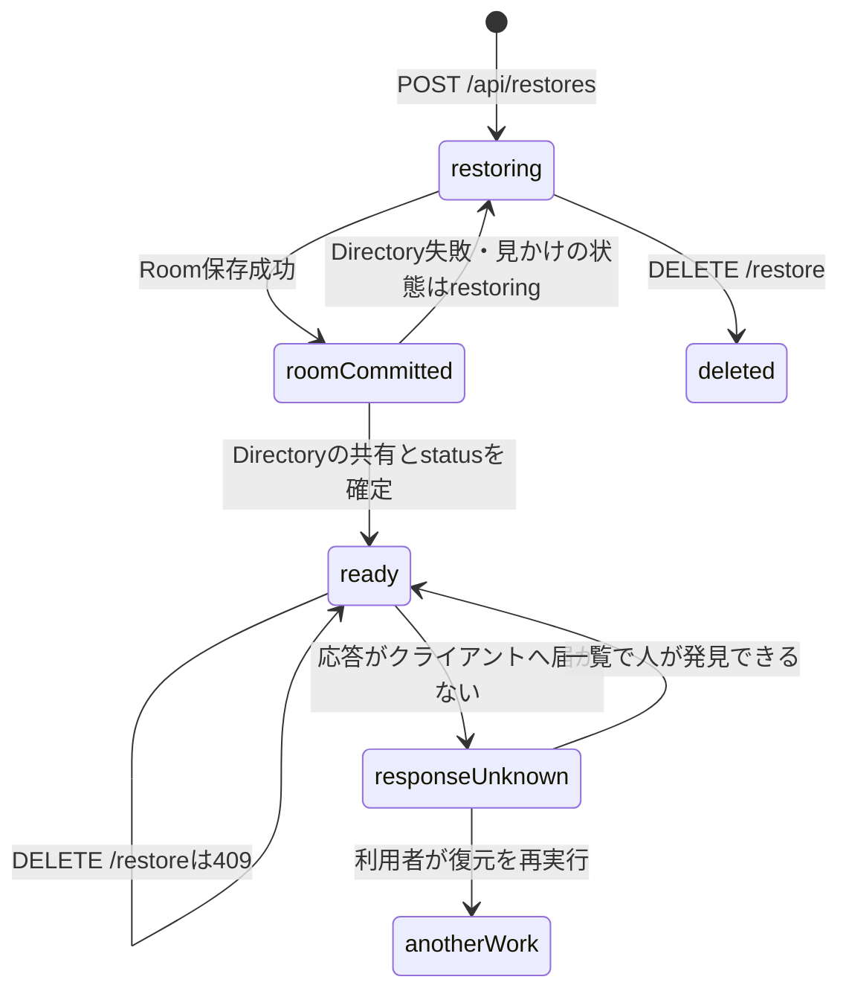
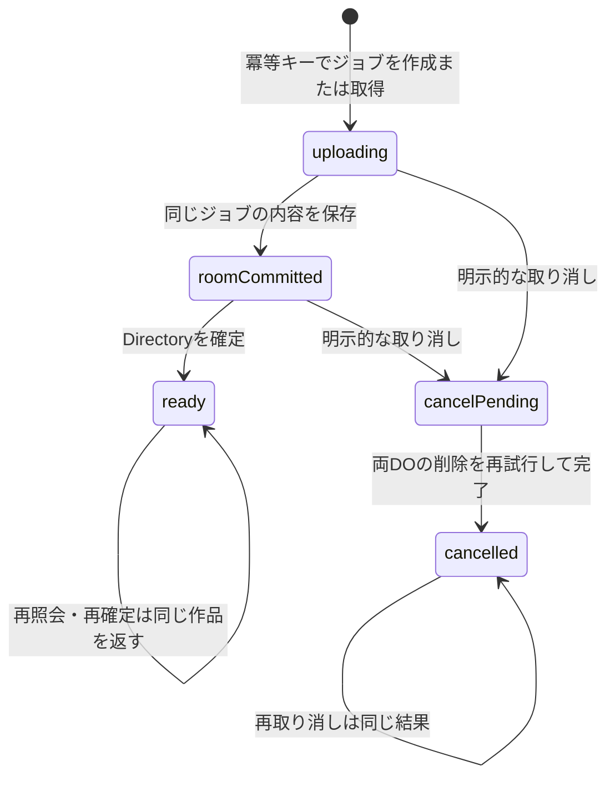

# VHSlide 0.37.0 障害復旧・整合性監査

調査日：2026-10-23（日本時間）。対象：このワークスペースにある未コミットの0.37.0。Git HEADは `aee3108bd57e7e039a22bd67b0bbd85ff09b062f` であり、HEADやGitHubの公開版を0.37.0と同一視しない。

## 1. 判定

**公開前の障害復旧試験として「不合格」**。

元作品の保護と、完成作品を後片付けで削除しない対策は動作した。しかし、応答消失後に同じジョブを再開するクライアント機能がなく、再実行で別作品を生成する。バックアップでは更新の見逃しだけでなく、同時には存在しなかったスライドと共有権限の組合せを成功として取得できた。指定されたB・Cの合格条件を満たさない。Dの実Chromebook上の合否は判定不能。

これは正常系のバックアップ全体が使用不能という判定ではない。今回指定された**障害時・同時編集時の公開条件**についての判定である。既存作品の消失や、途中作品の他者への公開は今回の試験では再現しなかった。

アプリの実装変更・修正・デプロイは実施していない。追加したのはテスト、テスト専用ハーネスの拡張、本報告書と証拠だけ。既存の未コミットの0.36.1/0.37.0の変更は維持した。アプリのバージョンは0.37.0のまま。

## 2. 試験環境と証拠

最初に [full-backup.md](full-backup.md) と実装・既存テストを読んだ。

- Cloudflareの試験はMiniflare/workerd、SQLiteのDirectory/Roomを一時ディレクトリへ作成。テスト専用RSA署名鍵とJWKSモックによる認証を使用した。
- 故障注入は、既存のdry-runバンドルを一時コピーし、Room確定直後／Room取得前後にテスト専用サービス呼び出しを挿入した。通常のWorkerソース・設定には故障注入用のAPIやフラグを追加していない。挿入位置は一意性を検査し、将来バンドルが変わったら黙って省略せず失敗する。
- A1は部分確定後にworkerdを再起動し、同じ永続領域から状態を再取得して再試行した。
- ブラウザーはLinux上のChromium **154.0.8037.57**、1366×768、CDPによるCPU **4倍スロットリング**。実ChromeOS、実Chromebook、実Googleアカウントではない。
- Node **v24.19.0**。ホストCPU表示はIntel Xeon Platinum 8573C、利用可能並列数4、コンテナのメモリ上限32GiB。Chromebookと同じメモリ制限を課していない。
- ブラウザー試験は実際の `backupArchive.ts` / `backupClient.ts` をテスト用ページにバンドルして呼び出した。アプリ全画面を操作するE2Eではない。UI応答性は16msタイマーの最大実測間隔で代替した。画面描画品質・指操作の評価ではない。
- 外部通信はモック／遮断。本番URL・共有ルーム・本番データへのアクセス、コミット、push、デプロイは行っていない。

再現コード：

- [tests/cloudflare/backup-recovery.test.ts](../tests/cloudflare/backup-recovery.test.ts)：`inject`、A1/A2/A3、B、CとABA混在スナップショット。
- [tests/cloudflare/harness.ts](../tests/cloudflare/harness.ts)：`harness.start(audit?)`。引数なしの既存試験は従来のバンドルと設定を使用。
- [tests/audit/backup-browser.ts](../tests/audit/backup-browser.ts)：大容量、実クライアントの応答消失・再実行、画像取得中の変更。

保存した証拠：

- [faults.log](audit-evidence/backup-recovery-2026-10-23/faults.log)：最終の故障注入試験。親1件＋子5件、計6件の期待した観測が成功。
- [unit-node.log](audit-evidence/backup-recovery-2026-10-23/unit-node.log)：既存の単体77件、Nodeバックエンド10件成功。
- [cloudflare-regression.log](audit-evidence/backup-recovery-2026-10-23/cloudflare-regression.log)：既存9件＋追加6件、計15件成功。その後A1の再起動・閲覧禁止検査を追加し、追加6件を再実行したのが `faults.log`。
- [chromium-performance.json](audit-evidence/backup-recovery-2026-10-23/chromium-performance.json)：容量別の生データと実クライアント応答消失試験。
- [chromium-response-and-export.json](audit-evidence/backup-recovery-2026-10-23/chromium-response-and-export.json)：応答消失の再確認と、実際に配布されたZIPの検査。
- [source-hashes.json](audit-evidence/backup-recovery-2026-10-23/source-hashes.json)：調査対象ソースとdry-runバンドルのSHA-256。真正性の証明ではなく、調査対象の識別用。

**テストが緑であることと、製品の合格は異なる。** 追加テストには「現状の不具合を再現できる」ことを期待値とするものがある。たとえばCは200と不整合の再現を検査しており、公開条件の合格を意味しない。

## 3. ケース別の結果

| ケース                               | 公開条件の判定               | 実測・観測                                                                                                                                                                                                                                               |
| ------------------------------------ | ---------------------------- | -------------------------------------------------------------------------------------------------------------------------------------------------------------------------------------------------------------------------------------------------------- |
| A1 Room確定直後にDirectory確定を失敗 | 合格（試験範囲内）           | 注入失敗は503。Roomには付箋が永続化済み。再起動後もDirectoryはrestoring。匿名GETは401、共有相手のGET・画像・WS・付箋POSTは404。同じIDへの再試行は200。付箋1件、共有1件、画像参照1件と画像バイナリ一致を確認                                              |
| A2 部分失敗後の再試行中に取り消し    | 合格（再試行が先行する順序） | 再試行をRoom確定後で停止しDELETEを待機させた。再試行200、取り消し409。完成作品は残る                                                                                                                                                                     |
| A3 部分確定作品の取り消し            | 合格（試験範囲内）           | DELETE 200。元IDへの再試行404、画像404、一覧から消える                                                                                                                                                                                                   |
| B 確定後に応答だけ消失               | **不合格**                   | サーバー確定200の応答をクライアントへ届けず切断。後片付けDELETEは409で作品を保護。一覧ready・同じID1件。ただし状態照会GET `/restore` は404、同IDのPOST再実行は409。実クライアントは状態を回復せずエラー表示。利用者の再実行で作品数が元作品込み2→3に増加 |
| C スライド・画像参照変更             | **不合格**                   | Room取得後に別クライアントのYjs更新をACKまで待ってもバックアップ200。変更前のスライド名・画像参照を返した                                                                                                                                                |
| C 付箋変更                           | **不合格**                   | Room取得後に別参加者が付箋POST 200。取得中の変更を検知せず200、バックアップの付箋数は変更前の1件                                                                                                                                                         |
| C 共有権限の変更が残る               | 合格（この比較だけ）         | Directoryの前後比較により409                                                                                                                                                                                                                             |
| C 共有権限を変更→元へ戻す            | **不合格**                   | 前後の値が一致し200。変更履歴を検知できない（ABA）                                                                                                                                                                                                       |
| C 複数DO間の不整合な組合せ           | **不合格**                   | 下記のD1/P0を200で返した。単に「古いが一貫した版」ではない                                                                                                                                                                                               |
| C 写真の取得中に付箋・共有を変更     | **不合格**                   | 実際のdownload関数がZIPを配布。ZIP内は付箋0/共有0、その時点のサーバーは付箋1/共有1。最終検証なし                                                                                                                                                         |
| D 約4MB・18MBの往復                  | 代替環境では成功             | ZIP生成・読み込み・新規復元、元作品不変・途中作品0を確認                                                                                                                                                                                                 |
| D 約45MBの復元失敗                   | データ保護は合格             | 元作品＋複製で作成者50MB上限を超え拒否。後片付け後は元作品のみ、内容不変                                                                                                                                                                                 |
| D 約120MB・278MB                     | 応答性の問題を観測           | ZIP生成・読み込み・破損拒否は完了したが長時間タイマーが停止。クラウドへの復元は容量上限のため未実施                                                                                                                                                      |
| D 実Chromebook                       | **判定不能**                 | 実機で測定していない                                                                                                                                                                                                                                     |

### Aの保証の限界

再試行で付箋は置き換えられるため件数は増えなかったが、Roomの `restoredComments` は毎回新しいIDを作る。「同じ結果を返す冪等な確定API」ではなく、「未公開の内容を再作成して確定できる」という意味の再試行である。画像のアップロードは再試行時に呼んでおらず、画像参照の重複がないことと同じ画像が取得できることを確認した。画像テーブル全件のSQLダンプによる監査ではない。

A2は再試行が先行し取り消しが待つ順序を意図的に作った。全スケジューリング、DO強制停止のあらゆる時点、Directoryトランザクション途中のプロセス停止、プラットフォーム障害そのものを網羅していない。A3は部分失敗の後に取り消しを完了させた順序であり、取り消しが先行する全競合の証明ではない。

### C：単一時点が存在しない再現

Pは共有権限の `comment`、Dはスライドのタイトルを表す。P0はtrue、P1はfalse。Yjs更新は別クライアントから送信しACKまで待機、権限変更もAPIの成功まで待機した。

```text
DirectoryがP0を取得（D0）
→ 権限をP1へ変更
→ スライドをD1へ変更
→ RoomがD1・付箋を取得
→ スライドをD2へ変更
→ 権限をP0へ戻す
→ Directoryの前後比較は一致
→ D1 / P0 のバックアップを200で返す
```

実際の組合せはP0/D0、P1/D0、P1/D1、P1/D2、P0/D2であり、**P0/D1は存在しなかった**。静止画の古い版を取得したという説明では整合しない。

## 4. 発見した問題と原因

### BR-1：複数DOの取得整合性を保証できない（P1・公開前に修正）

根拠：[cloudflare/directory.ts](../cloudflare/directory.ts) の `Directory.fetch`、`extra === "backup"`（549行付近）。共有を先に取得しRoomをawaitした後、配列のJSON値だけを比較する。履歴を表す永続リビジョンがなくABAを見逃す。[cloudflare/room.ts](../cloudflare/room.ts) の `/backup`（191行付近）はスライド・付箋を同じ同期処理で取得するが、その後の変更を示すトークンを返さない。

再現：上記Cの停止点で権限とYjs更新を順番に行う。`AUDIT_MIXED` が証拠。共有を復元する場合、ある時点の実作品と異なる編集ルールを再現する可能性がある。今回の試験から、元作品への不正な編集や閲覧ができたという結論は出していない。

修正案：RoomとDirectoryそれぞれで、保存対象の変更を全て含む永続的・単調増加のリビジョンを持つ。取得時と配布前に両方を検証し、途中変更時は再取得または失敗にする。具体案は第6節。

### BR-2：応答消失から同じ復元ジョブに戻れない（P1・公開前に修正）

根拠：[src/backupClient.ts](../src/backupClient.ts) の `restoreFullBackup`（33行以降）。ジョブIDは関数のローカル変数で、毎回 `POST /api/restores` を実行する。catchで途中削除を試み、409でも完成状態を照会せず一般的なエラーにする。`GET /api/decks/:id/restore` の実装がない。Directoryは通常GETと一覧でreadyを確認できるが、クライアントはこれを自動回復に使っていない。

再現：テストのPlaywright routeで確定POSTを `route.fetch()` により最後まで実行し200を確認、その応答だけ `connectionreset` で失わせる。完成作品は残る。再度 `restoreFullBackup` を呼ぶと別IDが作られ、共有等も別作品に複製される。同一作品内に共有レコードが重複する不具合とは区別する。

修正案：作成要求にホスト・バックアップの内容と結び付く冪等キーを付け、ジョブIDを保持する。状態照会を追加し、確定応答を失ったらreadyなら成功へ復帰、途中なら同ジョブを再開する。既知の完了ジョブへの再確定は同じ作品IDを返す。照会不能を失敗確定と混同しない。画像アップロードの応答消失時にも同じ画像を識別できる設計が必要（今回は画像応答消失の障害注入は未実施）。

### BR-3：写真取得まで含めた更新検知がない（P1・公開前に修正）

根拠：[src/backupClient.ts](../src/backupClient.ts) `downloadFullBackup`（4行以降）はメタデータGET→画像取得→ZIP生成→ダウンロードで、最後の検証がない。[src/cloud.ts](../src/cloud.ts) `prepareBackup` / `readyForBackupRestore` は自分の送信・付箋保存を待つもので、他者の送信やDOをまたぐ整合性の検証ではない。

再現：画像GETをテストブラウザーで止め、別のAPIクライアントから付箋・事前共有を追加してから画像を返す。ダウンロードファイルの `work.json` とサーバーの最新値が異なる。取得済みの版を使う仕様自体は成立するが、今回の「取得中の変更を検知する」という基準には未達。BR-1とは別に配布直前までの検証が必要。

### BR-4：同期ZIP処理と多数のバッファによる停止（P1/P2）

根拠：[src/backupArchive.ts](../src/backupArchive.ts) `createBackupArchive` は `zipSync`（95行付近）、`readArchive` は `unzipSync`（102行付近）、`hash` は `bytes.slice().buffer`（26行付近）。ストリーミング処理やWorker分離はない。

再現：第5節。少量でもこの代替環境で500msを超えるタイマー間隔があり、上限付近は数秒。ブラウザーが最終的に完了しても、操作可能という保証にはならない。ZIP生成中の取り消しやタブ応答不能への影響は実アプリUI・実機で追加確認が必要。

修正案：まずWorkerへZIP・検証処理を分離し、転送可能バッファでコピーを削減。次に一度に保持する画像・元ZIP・展開データを減らす。画像の復元前に容量を確認して早期に案内する。Worker化だけでは総メモリを必ず減らせるわけではない。

## 5. 大容量測定

授業における典型サイズの実績が未提供のため、5MB/20MBを**仮の探索用入力**、45MBを容量境界、120MB/280MBをアーカイブ単体ストレスとした。典型サイズ・合格時間を利用者と合意したわけではない。

768×768の決定的なノイズ画像をPNG化した実バイト列（1点2,030,312 bytes）を、異なるアセット参照で複製。単純なゼロ埋めバッファではないが、児童の実作品・写真の多様性を再現するものではない。各サイズ1回の測定であり中央値・p95ではない。

| 画像総量 MB | 画像点数 | ZIP生成 / 読み込み 秒 | タイマー最大間隔 生成 / 読み込み 秒 | 観測backing storage最大値 生成 / 読み込み MB | クラウド復元           |
| ----------- | -------- | --------------------- | ----------------------------------- | -------------------------------------------- | ---------------------- |
| 4.06        | 2        | 0.281 / 0.089         | 0.153 / 0.090                       | 16.5 / 16.5                                  | 2.180秒・成功          |
| 18.27       | 9        | 1.160 / 0.306         | 0.512 / 0.310                       | 63.2 / 73.4                                  | 9.368秒・成功          |
| 44.67       | 22       | 3.627 / 0.882         | 1.084 / 0.886                       | 144.4 / 179.0                                | 容量制限で拒否         |
| 119.79      | 59       | 3.146 / 1.910         | 3.349 / 1.940                       | 347.5 / 479.5                                | 未実施（容量上限超過） |
| 278.15      | 137      | 6.799 / 5.010         | 6.847 / 5.022                       | 648.1 / 899.8                                | 未実施（容量上限超過） |

4.06/18.27/44.67MBは実際に隔離サーバーへ保存した作品から画像をHTTP取得してZIPを生成した。119.79/278.15MBは保存上限を超えるためメモリ上の画像mapを使用した。ZIP生成の所要時間には取得・ハッシュ計算も含むので、両群を容量だけで単純比較しない。

単位は十進MB。`Runtime.getHeapUsage` の `backingStorageSize` を約50msごと＋処理前後で観測した値で、**全プロセスのRSSでも、厳密な最大使用量でもない**。JavaScript heap・embedder heapの別値もJSONへ保存。GCを各フェーズ前に実行。テストは元画像map・ZIP・読み込み結果を保持するため、実UIの生存期間やGCと完全には一致しない。観測最大値は下限寄りのサンプル値であり、Chromebookの必要RAMの推計には使わない。

破損したコピーの拒否試験も全サイズで完了。278MBで約3.861秒、タイマー最大間隔約3.894秒、backing storageの観測値約1,531MBとなった。これは正常ZIP・読み込み結果を保持したまま破損コピーも読むストレスであり、通常の単一ファイル読み込みのピークと混同しない。

44.67MBの元作品を残して複製すると、作成者50MBの上限に達する。復元エラーは期待する容量保護であり、300MBのZIP上限が50MBの保存上限を解除するわけではない。約2.301秒で失敗し、途中作品の削除後は作品数1、元のスライドJSONは一致した。4.06MB・18.27MBは元作品＋完成作品の2件、途中作品0、元作品不変を確認した。

120MB・278MBはサーバーの保存上限を緩めず、クライアント側の生成・検証のみ実施。画像参照はテスト用、クラウドへの復元完了・失敗回復の合格とは扱わない。ブラウザーのOOM・タブ強制終了・実機のメモリ不足は未試験。上限300MBちょうどの受理・境界性能も未確認。

## 6. 一貫性の保証範囲と改善案

### 現在確認できた範囲

| 層            | 確認できたこと                                                          | 保証できないこと                                               |
| ------------- | ----------------------------------------------------------------------- | -------------------------------------------------------------- |
| Room単体      | `/backup` 内のスライドと付箋の読み取りにawaitがなく、同じ同期処理で取得 | 他DOの共有情報と同じ時点、画像取得終了までの変更不在           |
| Directory単体 | 共有の値が前後で違う場合409                                             | 値が戻るABA、Roomとの単一時点                                  |
| 画像・ZIP     | 取得したバイトのハッシュ・参照関係の検証、破損拒否                      | ハッシュによる同時編集検知や真正性、配布時の最新性             |
| 自分の端末    | 通常の未送信更新・保存中付箋の待ち合わせ                                | 他端末だけの未送信更新、他参加者の将来更新                     |
| 復元          | 新規作品限定、途中は他者に非公開、ready作品の専用DELETEは409            | ジョブの永続的状態照会、クライアントの再接続・同一ジョブ再開   |
| Node          | 既存の正常系10件が成功。復元のSQLiteトランザクションはコードで確認      | 今回のCloudflare用故障注入結果をNodeの障害試験済みとは扱わない |

### 更新停止とリビジョン検証の比較

| 方式                           | 利点                               | 負担・失敗時の注意                                                                                                                                                            |
| ------------------------------ | ---------------------------------- | ----------------------------------------------------------------------------------------------------------------------------------------------------------------------------- |
| 編集を一時停止して取得         | 説明しやすく、停止中の取得を狙える | RoomとDirectory両方の全書き込み経路を止める必要。単一DOのロックでは不十分。切断・タブ終了時の解除、有効期限、編集者への案内が必要。大量画像の転送中ずっと止めると授業を妨げる |
| 永続リビジョンを検証して再試行 | 編集を続けられ、ABAも検知できる    | 更新漏れのない採番、DOをまたぐ順番、再試行回数と期限の設計が必要。編集が続けば取得を失敗として案内する                                                                        |

推奨は後者。Directoryの共有・参加・権限・保存する表示名等の変更、RoomのYjs・付箋・画像参照・画像削除等の変更を**それぞれの永続リビジョン**へ反映し、対象データと同じDBトランザクションで増加させる。単にYjsの更新数だけを数えても不十分。

DirectoryのrDを読み共有を取得→RoomのrRとデータを取得→rDを再確認する。これで共有がRoom取得を挟む期間に変わっていないことを検証する。さらに画像を取得した後、rD/rRと画像の存在・所属を再検証し、一致しなければ配布しない。確認自身もDOをまたぐので、単調性と読み取り順序により共通の有効区間が存在することを設計・テストで示す必要がある。単純に同時に2つのGETを投げれば十分と仮定しない。

変更検出時は回数を制限してメタデータから再取得、継続更新ならZIPを配布せず「編集中のため取得できません。少し待って再実行」と案内する。配布前検証を終えた後の新たな編集は取得対象外と仕様化する。未送信の他端末データはどちらの方式でも含められない。

これは修正案であり、**本監査では実装していない**。

## 7. 状態遷移

### 現在のサーバーとクライアント



`roomCommitted` / `responseUnknown` / `anotherWork` は説明のための概念状態。現在Directoryに永続化される復元進行状態は主にrestoring/readyであり、「Room保存済み」を状態照会できるジョブとして実装したわけではない。現在のクライアントは例外後に取り消しを試みるため、部分成功をそのまま安全に再開するUIにもなっていない。

### 推奨する状態管理（未実装）



応答不明はサーバーの失敗状態ではなく、クライアントの認識状態として扱う。ジョブID・実行者・入力の内容ハッシュ・画像対応・確定結果を保存し、再照会してreadyなら同じ作品を開く。途中なら同ジョブを再開。readyの取り消しは完成作品を削除しない。期限切れジョブの回収は、状態照会期間・再試行との競合まで設計する。

## 8. 修正の優先順位と再試験

| 優先      | 対応                                                   | 期待効果・影響                                                                          | 完了条件                                                                  |
| --------- | ------------------------------------------------------ | --------------------------------------------------------------------------------------- | ------------------------------------------------------------------------- |
| P1 最優先 | BR-1/3：両DOのリビジョンと配布前検証                   | 一貫性のないZIPを防止。Room/Directoryの全変更経路・保存形式・クライアントへ影響し難度高 | ABA混在と画像転送中の変更を検知し、成功配布しない。変更なしの正常系も成功 |
| P1        | BR-2：復元ジョブ照会・永続化・冪等な再開               | 完成作品の重複と状態の取り違えを防止。Node/Cloudflare双方のAPI・認可・UIに影響し難度高  | 確定応答消失・再読み込み後も同一ID、共有・画像・付箋が増えない            |
| P1        | 典型サイズとChromebook実機の合格基準を決定し測定       | 授業で許容できる停止時間・容量を判断。コード変更とは別に必要                            | 実機型番/RAM/Chrome版、典型作品、複数回測定、取り消し・失敗後の回復の記録 |
| P1/P2     | BR-4：ZIP/検証のWorker化とメモリ削減                   | 同期処理による操作停止を減らす。ブラウザー互換性・取り消しと転送方式の再検証が必要      | 合意した典型サイズで時間・応答性を満たす。上限ストレスは別枠で計測        |
| P2        | 容量の事前確認、再開・取り消し・期限切れジョブ回収のUI | 遅い容量エラーや途中作品の手動整理を減らす                                              | 写真送信前の容量案内、状態不明を区別する説明、回収と確定競合の試験        |

本試験ではP0に相当する既存作品の消失・第三者への途中作品の漏えいは発見していない。未試験の障害条件で絶対に起きないという保証ではない。

## 9. 再実行方法と残項目

リポジトリルートで実行する。`cf:check` はdry-runであり、本番デプロイではない。ビルド成果物をブラウザー試験の途中で差し替えない。

```bash
XDG_CONFIG_HOME=/tmp/vhslide-cf-config WRANGLER_SEND_METRICS=false npm --cache /tmp/vhslide-npm-cache run cf:check
node --test tests/cloudflare/backup-recovery.test.ts
node tests/audit/backup-browser.ts
npm --cache /tmp/vhslide-npm-cache test
node --test tests/cloudflare/*.test.ts
```

ブラウザー試験はローカル3187番を使用。既存インストールのChromium、Playwright、MiniflareとVite依存経由のesbuildを使用し、追加パッケージのインストールはしていない。生の結果は既定で `/tmp/vhslide-backup-browser-audit.json` へ出力される。Bと画像取得時のレースだけを再確認する場合：

```bash
AUDIT_SIZES=, AUDIT_OUTPUT=/tmp/vhslide-backup-browser-extra.json node tests/audit/backup-browser.ts
```

未確認／残項目：

- 実Chromebook/iPad/Windowsの測定。実際の児童の作品の典型容量と合格基準。
- 実アプリのUI全体、付箋入力途中、同時40人が編集を続ける状況でのバックアップ性能・再取得率。
- 復元の作成要求・画像アップロードの応答消失、ブラウザー再起動・タブ強制終了・OOM後の再開。
- 取り消しが先行する競合の全パターン、各DBトランザクション途中の強制停止、Cloudflare本番の再配置・サービス障害。
- Node/S3構成への同じ故障注入、実ネットワーク低速・切断、課金・多数校での負荷。
- 過去版の復元・ごみ箱・画像圧縮回収・Quillの警告。今回の障害試験で実装・解決した項目ではない。

**最終判定：不合格。** Aで確認した保護は維持しつつ、BR-1/2/3を修正して同じ障害試験を再実施することを公開前の条件とする。Dは代替測定の停止時間を改善・再確認し、実機の合格を別途取得する。
