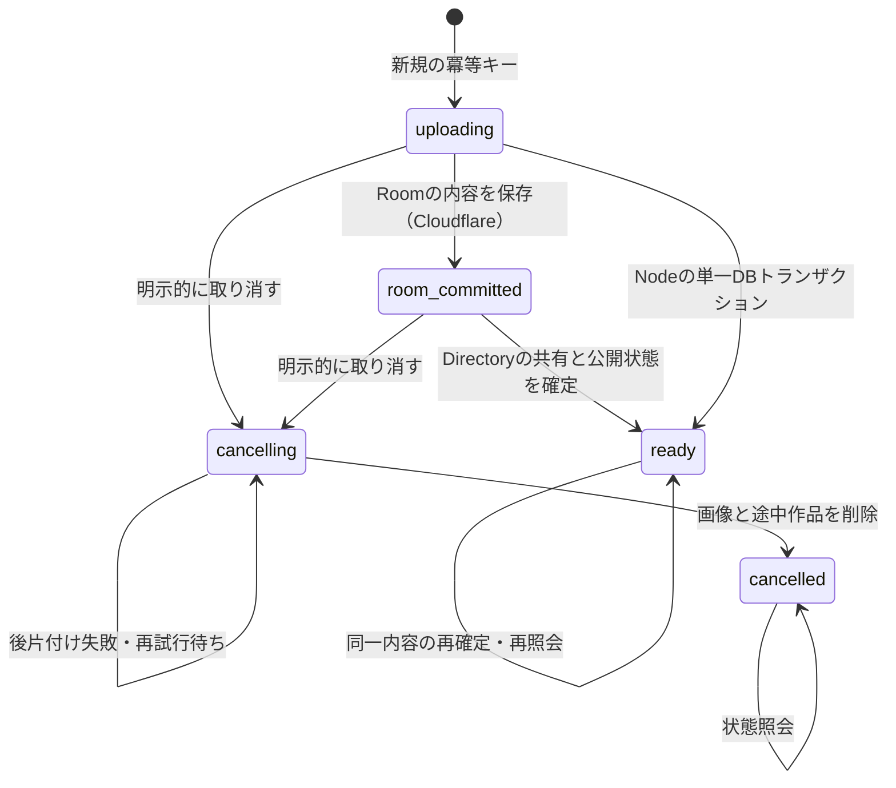

# 0.37.1 バックアップ整合性・復元ジョブの改修記録

日付：2026-10-24（日本時間）。[0.37.0障害監査](backup-recovery-audit.md) のBR-1/BR-2/BR-3を対象とする。過去の監査結果・証拠は上書きしない。本番デプロイ、公開ルームへのアクセス・更新は行っていない。

## 採用した整合性確認

編集をロックして画像転送中ずっと待たせる方式ではなく、**永続的な単調増加リビジョンを検証し、競合時は配布を中止する方式**を採用した。

### 保存と採番

`src/backupProtocol.ts` の `revisionSchema` が両バックエンド共通のSQLiteトリガーを定義する。`backup_revisions` は値を変更して元に戻しても増加し、削除・再起動でもリセットしない。更新と採番は同じSQL文／トランザクションで確定・ロールバックされる。上限を超えて整数からREALになる場合はCHECKで更新自体を拒否する。APIには10進文字列で返し、JavaScriptの整数精度に依存しない。

| 対象                 | 採番の対象                                                                                                                       |
| -------------------- | -------------------------------------------------------------------------------------------------------------------------------- |
| Cloudflare Directory | 作品ごと。decks、members、grants、recipients、assetsの挿入・更新・削除。参加者のusers.name/email変更は所属作品のリビジョンも更新 |
| Cloudflare Room      | Roomごと。snapshot、updates、comments、assets、asset_chunks、metaの挿入・更新・削除                                              |
| Node                 | 作品ごと。同じDB内のdecks、updates、comments、members、grants、recipients、assets、および参加者の名前・メール変更                |

表現の圧縮・スナップショットへの集約など、内容が等価な内部書き込みでも増える場合がある。これは安全側の再取得を生むが、変更の見逃しにはしない。特にNodeの終了時の集約が、取得済みチェックポイントを無効にすることがある。

### 取得と配布

1. DirectoryのrDと共有情報を同期的に取得する。
2. Roomからスライド・付箋・rRを同じ同期処理で取得する。
3. Roomリビジョンを再読し、Directoryも再確認する。どちらかが変われば409。
4. クライアントが画像を取得し、ZIPを生成する。
5. **ダウンロード前**に認証付き `POST /api/decks/:id/backup/verify` を呼び、rR→rDの順に再検証する。一致しない場合は409、通信・認証エラーの場合もファイルを配布しない。
6. 一致した場合だけダウンロードを開始する。

Nodeでは同じイベントループの同期処理で保存済みスライド・付箋・共有を読み、同一DBのリビジョンを確認する。バックアップ取得の自動再試行は**1回の試行のみ**。編集が続く場合は「取得中に作品・付箋・共有設定が変更されました。編集が落ち着いてから、もう一度バックアップしてください。」と表示する。

### 保証範囲

取得したスライド・付箋・共有設定が共通の時点に存在したことを検証する。画像取得・ZIP生成が済んだ後の検証にも同じリビジョンを用いる。Directoryの安定区間がRoomの読み取りを挟み、Roomも取得時から最終検証の読み取りまで変わっていないため、共通の有効時点が存在する。ABAも履歴カウンターで検出する。

最終検証のRoomリビジョン読み取りが線形化点になる。それ以後の新しい編集まで含む「常に最新の資料」の保証ではない。HTTP応答・ファイル保存まで編集を停止するものでもない。両DOをまたぐ単一DBトランザクションがあると仮定していない。

画像は新しい保存先へ書き込み、公開された参照先を別内容で上書きしない。Cloudflareでは画像チャンクと採番がRoom内のトランザクションで確定する。Nodeのファイル／S3保存とSQLiteが分散トランザクションになるわけではない。画像保存完了前は復元先を非公開にし、通常編集では画像保存完了後に参照をYjsへ追加する。参照変更と削除のDB操作は採番対象になる。サーバー外からのDB・S3ファイルの直接改変は保証外。

他端末だけに残る未送信データは含めない。更新前の古い画面は今回の配布前確認を実装していないため、0.37.1を再読み込みした画面が本保証の対象となる。

## 復元ジョブ

### 永続データとAPI

`restore_tasks` は作品とは別に保持し、取り消した後も状態を照会できる。ジョブID＝新規作品ID。所有者、冪等キー、バックアップ内容ハッシュ、共有選択、状態、確定内容ハッシュを保存する。ZIP本体や認証情報はジョブテーブルに保存しない。

| API                           | 仕様                                                                                                                                                                |
| ----------------------------- | ------------------------------------------------------------------------------------------------------------------------------------------------------------------- |
| POST /api/restores            | title、key、contentHash、applySharingを指定。同じ所有者・キーは同じジョブ。同じ内容ハッシュ＋共有選択も既存の取り消されていないジョブへ合流。最初は201、再実行は200 |
| GET /api/restores             | 自分の未完了・完了ジョブ一覧。取り消し済みは一覧から除外                                                                                                            |
| GET /api/restores/:id         | 自分のジョブの状態・作品名・画像件数・共有選択。取り消し済みも照会可能                                                                                              |
| GET /api/decks/:id/restore    | 同じ所有者限定の状態照会                                                                                                                                            |
| POST /api/decks/:id/assets    | `X-Restore-Image` に画像のSHA-256。サーバーが実バイトを検証し、ジョブID＋画像ハッシュから同じ保存先IDを生成する                                                     |
| POST /api/decks/:id/restore   | 作品・付箋・共有を確定。同じ内容で再実行した完了ジョブは同じ作品IDを返す。異なる確定内容・共有設定は拒否                                                            |
| DELETE /api/decks/:id/restore | 未完了ジョブだけ取り消し。確定済みは409で保護。途中の取り消しは再試行できる                                                                                         |

認証・同一生成元の検査を維持する。他のアカウントはジョブ状態を照会できない。復元中の通常GET、画像GET、WebSocket、コメントや共有の操作も引き続き拒否する。冪等キーを別内容に使い回す要求は、他の内容一致ジョブが存在していても拒否する。

同じ画像の再送で画像数・容量予約が増えない。Nodeではさらに `restore_uploads.ready` で予約と本体保存の完了を区別し、未完了の画像を参照した確定を400で拒否する。予約だけを残して画像本体の書き込み前に停止した状態をテストで再現し、修正前は200、修正後は400になることと、同じ画像の再送で復旧して確定できることを確認した。予約の後、画像本体の保存途中で停止した場合も同じIDを再利用する。Nodeでは既存バイトのハッシュも確認し、保存途中の予約から再開する。Cloudflareの画像チャンク書き込みは単一トランザクションで、同じ画像IDの再送は追加書き込みしない。

### 状態遷移

NodeはRoom相当のスライド・付箋と共有情報を同じDBトランザクションで確定するため、外から観測できるroom_committed状態はない。最終的なAPIの意味は両バックエンドで共通。

CloudflareではRoomの `restore_commit` メタ情報を内容ハッシュと同じトランザクションで保存する。Directoryが失敗しても、再試行でRoomの付箋を再作成せず、Directoryの確定をやり直せる。Roomの応答だけが失われた場合は、DirectoryがuploadingのままでもRoomが同じ確定ハッシュを識別する。この場合のuploadingはDirectoryの最終確認済み状態であり、Roomが未保存であるという断定ではない。無効な画像参照などでRoomが拒否した入力は、ジョブの確定内容を固定しない。

Directoryの復元変更は入力ゲートで直列化し、Nodeはジョブごとの非同期ロックを用いる。Directoryでは認証・所有者確認後、受信本文を上限内で読み終えてからゲートへ入る。低速クライアントの本文受信中にDirectory全体をロックしない。ゲート内でも状態と認可を再確認する。確定が先なら後続の取り消しは409、取り消しが先なら確定は拒否する。取り消し中は非公開・書き込み不可。DOの削除済みフラグも維持し、遅れたアップロードで作品を再生成させない。

応答不明はクライアントの認識状態であり、「失敗だから削除」とは扱わない。画像・確定要求は同じキーで最大3回送信し、それでも応答がない場合は状態照会でreadyを確認できれば成功へ復帰する。429の待機は最大2回×30秒で、中断可能。一般の接続・5xx再試行も有限回とする。

### 再読み込みと利用者の確認

未完了ジョブをクラウドの作品一覧に表示する。タブを閉じた・再読み込みした場合は、サインイン後に同じZIPを再選択して再開できる。ZIP本体をブラウザー保存領域に自動複製しないので、ファイルの再選択は必要。

共有設定は既定でオフ。前回共有ありを選んだジョブの再開時も、チェックを再確認するまで実行できない。ファイルや共有選択が前回と異なる場合は再開しない。通常の同じファイル＋共有選択の再実行は完成済みの同じ作品を開く。意図的に別コピーを作る場合は、作品のコピー機能を使う。

通信エラーでは途中作品を自動削除しない。利用者が明示的に取り消した場合だけ削除する。パネルを閉じる／処理を中断する場合は再開可能な状態を保つ。元作品は上書きしない。バックアップ内のユーザーID・招待リンクを復元しない。安定した行・列IDと認可方式は変更していない。

既存ZIPの `vhslide-archive` / `vhslide-backup` version 1は維持。取得チェックポイントは配布前の通信でのみ使い、ZIPへの必須フィールドを追加していない。旧版の非公開復元先はlegacyジョブへ移行する。ただし旧版に内容ハッシュの記録がないため、新版と同じファイル一致の自動確認はできない。

## 変更ファイル

| 分野                     | ファイル                                                                                                                |
| ------------------------ | ----------------------------------------------------------------------------------------------------------------------- |
| 共通の採番・プロトコル   | src/backupProtocol.ts（新規）                                                                                           |
| Cloudflare               | cloudflare/directory.ts、cloudflare/room.ts                                                                             |
| Node                     | server/app.ts                                                                                                           |
| クライアント・再開画面   | src/backupClient.ts、src/BackupPanel.tsx                                                                                |
| バージョン・履歴         | src/releaseHistory.ts、package.json、package-lock.json（0.37.1）                                                        |
| 単体・両バックエンド回帰 | src/backupProtocol.test.ts、tests/support/backup-protocol.ts、tests/server/app.test.ts、tests/cloudflare/worker.test.ts |
| 障害注入・ブラウザー     | tests/cloudflare/backup-recovery.test.ts、tests/cloud/collaboration.spec.ts、tests/audit/backup-browser.ts              |
| 文書                     | docs/full-backup.md、本記録、今回の証拠ファイル                                                                         |

## 検証結果

最終ビルド・Cloudflare dry-runは成功。本番へはデプロイしていない。主JSチャンクは約559kBで、既存の500kB超警告は残る。テストはローカルの独立したDB・Room、テスト署名JWT／注入した認証検証器を使用し、本番データには接続していない。

| 試験                               | 結果                                                                                                                                                                                                  | 証拠                                                                                                                                                                                                                                                                            |
| ---------------------------------- | ----------------------------------------------------------------------------------------------------------------------------------------------------------------------------------------------------- | ------------------------------------------------------------------------------------------------------------------------------------------------------------------------------------------------------------------------------------------------------------------------------- |
| 単体                               | **80件成功**                                                                                                                                                                                          | [unit-node-final.log](audit-evidence/backup-recovery-2026-10-24/unit-node-final.log)                                                                                                                                                                                            |
| Nodeバックエンド                   | **12件成功**。並行作成、画像再送、再起動、チェックポイント、取り消し競合、画像予約のみの状態を含む                                                                                                    | 同上                                                                                                                                                                                                                                                                            |
| Cloudflareバックエンド・障害注入   | **17件成功**（通常10件＋障害注入の親1件・子6件）                                                                                                                                                      | [cloudflare-final.log](audit-evidence/backup-recovery-2026-10-24/cloudflare-final.log)                                                                                                                                                                                          |
| ローカル編集画面E2E                | **129件成功・37件スキップ**。スキップはhover／PCホイール等の端末条件によるもの。成功件数へ含めない                                                                                                    | [local-browser-final.log](audit-evidence/backup-recovery-2026-10-24/local-browser-final.log)                                                                                                                                                                                    |
| NodeクラウドUI全体                 | **22件成功**。最終の画像完了保護・画面更新後、対象2件も再実行して成功                                                                                                                                 | [全体](audit-evidence/backup-recovery-2026-10-24/node-browser-full.log)・[最終対象2件](audit-evidence/backup-recovery-2026-10-24/node-browser-final-targeted.log)                                                                                                               |
| CloudflareクラウドUI全体           | 全22件を実行し、初回20件成功・2件タイムアウト。分離再試験6件は5件成功・1件が45秒の全体予算切れ。フロー全体90秒へ変更後の最終4件は全件成功し、失敗した見出し同期・共有管理・新しい復元フローを確認済み | [初回](audit-evidence/backup-recovery-2026-10-24/cloudflare-browser-initial.log)・[45秒での分離試験](audit-evidence/backup-recovery-2026-10-24/cloudflare-browser-isolated-45s.log)・[最終4件](audit-evidence/backup-recovery-2026-10-24/cloudflare-browser-final-targeted.log) |
| 実クライアントの応答消失・配布中止 | **成功**。完了応答を失っても同じID、再実行しても作品数2のまま。画像取得中の付箋・共有変更でダウンロード0。取り消し応答の消失も状態照会で回復                                                          | [browser-recovery.json](audit-evidence/backup-recovery-2026-10-24/browser-recovery.json)                                                                                                                                                                                        |
| ビルド・型検査・dry-run            | **成功**。dry-runはデプロイではない                                                                                                                                                                   | [build.log](audit-evidence/backup-recovery-2026-10-24/build.log)・[cloudflare-dry-run.log](audit-evidence/backup-recovery-2026-10-24/cloudflare-dry-run.log)                                                                                                                    |

最終4件のCloudflare UI確認と最終2件のNode UI確認は、デスクトップとChromiumのタッチ端末エミュレーションの両方で実施した。「Cloudflare全22件を最終設定で一度に全件成功」とは報告していない。初回失敗のログも保存し、再実行と区別する。

ローカルE2Eの初回並行実行は、多数の時間制約付き試験が失敗したため中断した。[そのログ](audit-evidence/backup-recovery-2026-10-24/local-browser-parallel-interrupted.log)も保存した。最終は1 workerで全166件を最後まで実行し、129成功・37スキップとなった。ホイールの650ms判定など、個々の性能・同期の期待値は緩めていない。画面高さのテストだけは、従来からある下部シートバーを差し引き、ヘッダー104pxの上限とバーまでの表示領域を別々に確認するよう修正した。

### A・B・Cの最終確認

| ケース                                 | 修正後の結果                                                                                                                             |
| -------------------------------------- | ---------------------------------------------------------------------------------------------------------------------------------------- |
| A1 Room確定後にDirectory確定失敗       | 非公開を維持。再起動後、同じジョブで正常確定。画像・付箋・共有は1件ずつ、付箋IDも不変                                                    |
| A2 再試行が先行する取り消し競合        | 確定200、待機した取り消し409。完成作品を保護                                                                                             |
| A3 取り消し後の再試行                  | 状態はcancelled、作品・画像は開けず、確定は拒否。両バックエンドの並行試験でも安全などちらかの順序へ直列化                                |
| A4 Roomの保存後、その応答だけ失敗      | Directoryの確認済み状態はuploading。再起動後に同じ確定を再試行し、保存済み付箋IDを維持して完了                                           |
| B 確定HTTP応答を失う                   | ジョブ照会でreadyを取得。ブラウザーでは全3回の確定応答を遮断しても成功へ復帰し、同じIDを開く。再実行で作品・画像・付箋・共有を増やさない |
| 画像アップロードの応答消失             | 同じバイト・ジョブは同じ保存先。並行再送、再起動後の再送、ブラウザーの応答遮断で画像数1を維持                                            |
| 画像の予約後、保存前の停止（Node）     | 予約行だけでは確定400。同じバイトを再送すれば同じ画像IDで保存を完了し、その後は確定200                                                   |
| C スライド・画像参照・付箋・権限の変更 | 取得中の全ケースを409で拒否                                                                                                              |
| C ABA・存在しない組合せ                | 前後のJSONが一致しても409。D1/P0のような混在ZIPを成功扱いにしない                                                                        |
| C 画像取得後                           | 配布前検証で拒否し、実際のダウンロード数0                                                                                                |

画像予約の追加ケースは、[修正前の失敗](audit-evidence/backup-recovery-2026-10-24/node-image-reservation-before.log)と[修正後の成功](audit-evidence/backup-recovery-2026-10-24/node-image-reservation-after.log)も保存した。修正前のログは未解決の現行失敗ではなく、故障状態を再現して問題を確認した証拠。

対象ソースとバンドルの[SHA-256一覧](audit-evidence/backup-recovery-2026-10-24/source-hashes.json)も保存した。ワークスペース上の未コミットの変更が対象であり、GitHubや本番の版と同一ではない。

## 残項目と公開判断の範囲

- BR-4の同期ZIP生成・展開、大容量時のメモリ使用は未解決。今回の整合性・再開の修正が、300MBを快適に処理できる保証になるわけではない。
- Chromebook実機の型番・RAM・Chrome版を記録し、授業で使う典型サイズを合意して、生成・読み込み・復元時間、UI停止、取り消し、タブ再起動後の回復を測定する必要がある。
- 実S3環境、Cloudflare本番の強制再配置・DO実行上限、低速ネットワークの実測は未確認。テストは独立したローカル環境であり、本番へデプロイしていない。
- 同じファイルと共有選択は、完成済みの既存ジョブへも合流する。完成先で後から編集された内容・権限を再実行で巻き戻さない。同じバックアップから明示的に別ジョブを作る専用操作は未追加であり、今後の復元UIの検討項目。
- ジョブの履歴・冪等キーは保持する設計。長期の保存期間・管理上の回収・課金負荷の設計は今後の運用項目。
- 最終検証の線形化点以後の編集、未送信の他端末データ、サーバー外からの保存物の改変は保証外。

BR-1〜3の試験合格と、実機・運用・大容量を含む公開運用全体の合格を区別する。

## 判定

**BR-1〜3の改修と、指定された障害回帰ケースは合格。公開運用全体の最終判断は保留。** 実Chromebook・大容量処理・実運用の試験は未完了であり、今回の成功件数を根拠に検証済みとは扱わない。本番へのデプロイは行っていない。
