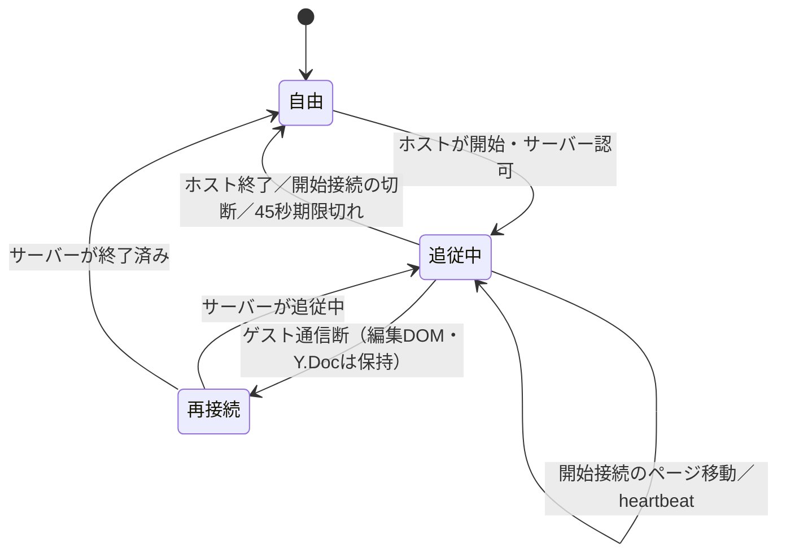

# ホスト追従モード 段階記録

2026-10-29。仕様v1.0と、`host-follow-preflight.md`末尾に記録した確認済みの修正方針に従う。工程を混ぜず、各工程のコード・検証・未解決を区別する。

## Step 1：状態・権限

実装：`src/hostFollow.ts`にページID／シートIDを用いたmap/page対象、セッション世代、開始者、開始時刻、更新リビジョンを定義。`server/app.ts`・`cloudflare/room.ts`で認証済みWebSocket制御メッセージを受ける。作品のYjs更新とは別であり、バックアップや通常のローカル作品保存へ制御状態を混ぜない。

開始・移動・終了は、送信時点の実際のホスト権限をサーバーが確認する。開始した接続のみが移動を送れる。同じホストの別接続は明示的に終了できるが、古い世代の終了要求で新しい追従を終了できない。接続時に現在の制御状態を返す。CloudflareではHibernationを考慮してRoomの制御用metaへ保存し、開始元接続が存在しなければ解除する。Nodeのプロセス再起動時は非追従になる。

検証：単体168件・Node API17件・Cloudflare API23件成功。両バックエンドで実際のWebSocketを使用し、全編集権限を持つゲストの開始・移動・終了拒否、偽装属性の無視、不正な対象、別ホスト接続からの移動拒否、新規接続への現在状態、古い世代の終了拒否、別作品への非干渉、Yjs状態が追従制御で変更されないことを確認。モックのみの検証ではない。

初回はNodeのstrip-onlyでTypeScriptのparameter propertyが使えない問題を検出して通常のフィールド代入へ変更。ビルドでテスト用セッションIDの型推論が狭すぎる問題も修正。最終ビルドは成功。

未解決：クライアント表示同期・UI・ロック・編集中保護はまだ付けていない。接続closeの基本処理はあるが、通信断の検出期限と再接続時のクライアント復帰はStep 6で検証する。遅延目標の達成もまだ測定していない。

## Step 2：表示同期

実装：`src/cloud.ts`で作品更新と別のfollow-state／follow-errorを受信し、セッションごとの制御応答を扱う。状態はCloudWorkspaceのメモリのみで保持し、既存のキャッシュ経路へ渡さない。`src/HostFollowView.tsx`でページと、対象シートの2次元マップを閲覧専用表示する。マップは画面内付近のカードのみを描画し、1000枚を常時Canvas化しない。ホストの表示フィルタ・ズーム・スクロールの完全複製は対象外で、対象シートの俯瞰と注目ページを表示する。

検証：Nodeの実サーバー＋複数サインインブラウザで2件成功。サーバーが認可したホスト接続からページ→別シートのマップ→終了を送り、ゲスト表示と元の編集Canvasが同じDOMで保持されることを確認。UIはまだ付けず、試験用の独立ルームで操作した。

未解決：この段階ではホストの操作ボタンと完全な操作ロックをまだ付けていない。IME・カーソル保持、制限ゲスト、再接続・実測は後続ステップの対象。

Step 2追加検証：Cloudflareの実実行系＋ブラウザでも2件成功。

## Step 3：ロック・状態表示・ホストUI

実装：ホストの「全員を集合／追従を終了」と接続ゲスト人数、ゲストのホスト名付き追従中表示を追加。追従中のキー・入力・貼り付け・通常の編集操作を遮断する。制御送信前に既存の作品更新をflushし、未送信で作成したページをサーバーへ送る順序を守る。ゲストの編集権限自体は書き換えず、進行中の保存は継続する。

検証：Nodeの実サーバー＋PC／タッチブラウザ4件成功（Step 2の2件を含む）。ホストUIのワンアクション開始・終了、ページとマップの切替、ゲストに終了ボタンがないこと、Escape／矢印／Undo／通常入力で追従を解除・変更できないこと、元の編集Canvasが保持されることを確認。

未解決：この段階の単純な入力遮断を、IMEとカーソル保持に対応させるのはStep 4。厳密な未保持は今回の要件ではなく、表示の一時制限とする。

## Step 4：編集保護

実装：編集コンポーネントをマウントしたまま表示レイヤーで覆い、切替前に通知を表示する。`useFollowLock`でフォーカス、textareaの選択方向／カーソル、DOM選択とスクロールを保持する。Quillでは`CloudText`の既存エディターへ復帰し、Y.Textの相対位置を用いて選択範囲を復元する。追従のためのblurで編集終了処理を走らせない。割込前に進行中だったIMEの確定入力は保存のため完了を許可し、その後は追従レイヤーへフォーカスを移す。通常の新規入力は遮断する。

検証：Node＋PC／タッチの編集保護4件成功。実際の編集DOMの維持、全文保持、選択範囲の復元、通知がページ表示より先に描画されることを確認。Chromium CDPのIME機能で変換中「にほん」を割込後に「日本」と確定して保持できることを確認した。これは実Chromebookの物理IMEの検証ではない。

初回のブラウザ試験はクラウド接続前にローカルのサムネイルをクリックする試験側の競合があり、接続完了を待つ条件を加えて再実行した。画像やページを追従用に保存し直す処理は追加していない。

未解決：実ChromebookのIME、同時のページ削除・権限剥奪との組合せは最終報告で区別する。ホストによる削除・権限変更を追従のために無効化しない。

## Step 5：制限ゲストの一時表示

実装：追従レイヤーで対象ページ／対象シートの全体マップを表示し、元の担当フィルタ・編集DOMは保持する。終了時は元の担当ページに復帰する。追従中の権限変更は解除後に現行権限で再評価し、権限を復活させない。

検証：Node＋PC／タッチの2件成功。担当3ページのゲストが制限外ページと9ページの全体マップを一時閲覧し、編集UIがないこと、追従前後で既存ローカル保存内容が変わらないこと、終了後は元の編集Canvas／担当3ページ表示へ戻ることを確認。厳密な端末への未配信・未保存は利用者との合意により対象外。

## Step 6：再接続・異常系

実装：開始接続から15秒ごとのheartbeatで45秒の追従期限を更新する。Nodeは1秒間隔の期限確認、CloudflareはDurable Objectの永続alarmで終了を通知する（休眠を妨げる常駐タイマーは追加しない）。開始接続が閉じた場合は即時終了し、別接続の切断や古いセッションからの要求では現在の追従を終了させない。ゲストの再接続時は最新状態を送信する。端末オフライン時は追従を解除し、通信が無応答のまま残った場合も60秒の受信監視で解除・再接続する。受信監視は端末の壁時計とサーバー時計の差に依存しない。

実際に発見・修正した問題：

- オフライン処理が先にソケット参照を外すため、既存のcloseハンドラーだけでは追従解除が走らなかった。offline処理でも明示解除するよう修正し、PC／タッチの再接続回帰試験で確認。
- Cloudflareのclose通知に含まれる予約済みコードをそのまま応答へ使うと、その後の終了処理が完了しない場合があった。開始接続IDで明示的に追従を終了させ、応答コードを正規化した。実workerdの接続試験で確認。
- 集合ボタンを最上段へ追加すると右端の操作が見切れたため、マップ／編集の共通操作列へ配置した。開始・終了を同じ位置のボタンで行える。

## 状態遷移・保証範囲

- 共有作品の所有者をNode／Cloudflareの両サーバーで検証する。クライアントが送るホスト名・権限フラグは信用しない。
- 追従制御はYjs作品データとは別管理。バックアップ、担当行・列ID、編集権限を変更しない。同期先はシートID・ページIDで指定し、並べ替えによる座標変化と分離する。
- マップは対象シートの全体マップを表示する。ピクセル単位のズーム・スクロールやホスト個人のフィルタ設定は複製しない。描画は見える範囲へ限定する。
- ゲスト自身による通常UIでの解除・ページ移動・編集は遮断する。割込前から進行中のIME確定と未送信保存は完了を許可する。これを止めるサーバー側の一律な編集禁止は設けない。
- 元の編集ページ・選択範囲・フォーカスを保持する。ただし、ホストによる同時のページ削除・権限剥奪を取り消したり、削除済みDOMを復活させたりしない。
- この機能は授業中の表示制御。ユーザー合意により、既存の全データ配信・端末キャッシュは維持する。追従用にページや画像の追加永続コピーは作らない。
- 切断検知は無時間ではない。正常closeは即時処理し、通知されないホスト停止はサーバー期限45秒、ゲスト単独の無応答は受信監視約60秒＋実行環境のスケジューリング時間で解放する。バックグラウンド凍結中はJavaScript自体が動かず、復帰時にも再確認する。

## 検証の区別

試験は独立したローカルRoom／Directoryとテスト署名JWTで実施した。本番の作品データは使用しない。JWT署名検証、実際のWebSocket、Nodeサーバー、Cloudflare workerd／SQLite Durable Objects、Linux Chromiumを通す。モックだけを成功根拠にしない。Chromium CDPによるIME試験は物理ChromebookでのIME試験とは区別する。

実Chromebook／学校回線で残る確認：40人の実画面での表示遅延、物理IMEの変換・候補選択、スリープ復帰、無線LAN切替、低メモリ端末で1000枚の全体マップ、授業中の長時間利用。ローカルの40接続測定は40台の実端末を意味しない。

## 根拠となる実装・試験

- `src/hostFollow.ts`: `transitionFollow`／`expireFollow`（権限、開始接続、世代、期限）。
- `server/app.ts`: follow-control、close、followTimer。`cloudflare/room.ts`: followState、endFollowFor、alarm（実サーバー側の認可・復旧）。
- `src/cloud.ts`: followCommand／armFollowLiveness／resetFollow／offline（クライアント接続と制御）。
- `src/App.tsx`: followTarget、followLocked、ホスト操作ボタン、担当制限への復帰。
- `src/HostFollowView.tsx`: 表示レイヤー／FollowMap。`src/useFollowLock.ts`、`src/CloudText.tsx`: 編集DOMと相対選択位置の保持。
- `tests/support/host-follow.ts`: Node／workerd共通の偽装拒否、世代、別作品、実時間45秒期限、切断、40接続到達時間。
- `tests/cloud/host-follow.spec.ts`: PC／タッチで表示・ロック・編集／IME保護・担当外表示・再接続・heartbeat・40接続と描画の測定。

## 最終検証（Linux Chromium、2026-10-29作業）

| 検証 | 結果 | 証拠 |
| --- | --- | --- |
| 単体／Node API | アプリ168件、Node18件成功 | audit-evidence/host-follow-0.58.0/unit.log |
| Cloudflare型検査・dry-run・実API | 24件成功 | 同cloudflare.log |
| Node PC／タッチ | 16件成功 | 同node-browser.log |
| Cloudflare PC／タッチ | 16件成功 | 同cloudflare-browser.log |
| 手描き・複数選択・リンク・ノート等の回帰 | 26件成功 | 同local-regressions.log |
| ビルド・アプリ／両サーバー型検査 | 成功 | 同build.log、cloudflare.log |

初回のCloudflareブラウザ回帰では既存のforced-filterのPC試験が90秒でタイムアウトした。追従12件は成功した。その後、同じ対象に描画遅延試験を加えて全16件を再実行し、forced-filterを含めすべて成功した。初回失敗を成功扱いに置き換えるものではなく、最終再試験を別の証拠として記録する。全E2Eスイートは今回実行していない。

### 40接続時の通常ページ移動

同一環境の独立作品で、ホストアプリ1・開始制御接続1・ゲストアプリ1・受信ゲスト接続37の合計40接続。20回のページ切替に対し、コマンド送信から実ゲストDOM更新・2回のrequestAnimationFrameまでを測定（開始時通知は除外）。残り37接続は受信負荷であり、40台の画面描画ではない。待機・自動化の遅延も含み、統計的な長期性能保証ではない。

| 実行系 | ブラウザ設定 | P95 | 目標1秒 |
| --- | --- | --- | --- |
| Node | PC | 117.5ms | 達成 |
| Node | タッチ | 135.4ms | 達成 |
| Cloudflare workerd | PC | 168.9ms | 達成 |
| Cloudflare workerd | タッチ | 134.1ms | 達成 |

全測定値は `audit-evidence/host-follow-0.58.0/render-40-metrics.json`。実Chromebook／学校回線・本番Cloudflareでこの数値を測定したものではない。

### 受入基準との対応

| 仕様 | 確認 |
| --- | --- |
| 開始・ページ／マップ同期 | 実API＋Step 2/3 |
| ゲストの操作・自己解除禁止、ホスト名表示 | Step 3 |
| 通知先行、編集内容と選択範囲の保持・復帰 | Step 4、Chromium IME試験 |
| 制限外の一時表示・終了後の制限復帰 | Step 5、既存キャッシュ不変 |
| 再接続で追従へ自動復帰 | Step 6 |
| ホスト切断／通知されない停止で自動終了 | Step 6、実時間45秒のAPI試験 |
| ゲストが開始・移動・終了を偽装しても拒否 | Node／workerd両API |

この表は上記のローカル実行系での受入確認。実機検証まで完了したという判定ではない。

最終の操作ロック確認後、NodeのStep 3／4／6を追加で8件再実行し、すべて成功した（`node-lock-final.log`）。既存の表セル・範囲選択の先行登録キーハンドラーにも追従中のガードを設け、追従開始前に取得済みのポインターによる背景への移動入力も遮断している。通常時の編集操作は変更しない。

## 公開結果

v0.58.0を https://vhslide.overdozer1124.workers.dev へ公開。Version ID: `ceefacbb-fffe-41ea-9f3a-8ad359bd3b2e`。有料設定・R2追加・wranglerのvars／migrations変更・mainへのマージ／pushは行っていない。

公開後：`/healthz`が `{"ok":true}`、公開画面の最新履歴が「v0.58.0 ホストの画面に全員が追従」、ブラウザ例外0件。既存の発表者ノート・別窓・ページ移動・終了も独立した端末内データで確認した。実際の公開ファイルを、TLS検証するcurlのGETで取得しChromiumへ渡した（この環境のChromiumとプロキシCAの組合せによる制約）。本番APIへの書き込み・本番ルームの操作は行っていない。公開先での実アカウント間の追従動作は未検証で、上記のNode／workerdと実ブラウザの独立ルーム試験を根拠とする。

## v0.58.1：集合表示のサイズ修正

利用者の実画面で、集合中のスライドが小さいまま表示される不具合を確認した。前版のブラウザ試験は表示先IDと編集保護を検証したが、スライドの実寸を検証しておらず、この不具合を検出できていなかった。

原因：`HostFollowView`は最初の通知中にページのDOMをまだ生成しないため、親から呼ぶ`useFitCanvas`の初回layout effectではrefがnullになり、その後の初回表示でも再計算・ResizeObserverの登録が行われなかった。仮のzoom=0.5が残っていた。マップとページの往復にも同じ問題があった。

修正：実ページの表示コンポーネントがマウントされる時点でサイズ計算と監視を開始する。ページ見出しとCanvasの領域を分離し、余白を除いた実領域に縦横比を保つ最大サイズで表示する。未取得ページが後から届く場合も、実ページの生成時に計算する。さらにモバイルでは背景エディターの横はみ出しによりlayout viewportがvisual viewportより大きくなる場合があったため、集合レイヤーを`100dvw × 100dvh`へ明示的に制限した。

ゲスト表示は「〇〇さんの画面を表示中」、ホストの終了ボタンは「集合を終了」、ホストの状態は「全員に表示中」に変更。同期方式・編集ロック・権限・データ保存は変更していない。

回帰試験：初回、ページ→マップ→ページの往復、1366×768／1024×600／1920×1080への画面変更について、スライドの実寸と画面内への収まりを確認する。修正前のPCでは利用可能幅に対し約34％しかなく新しい試験が失敗することを確認。タッチ端末での横はみ出しも再現後に修正し、PC／タッチのサイズ試験2件で成功した。後続の全体追従回帰結果・公開結果は以下に追記する。

証拠は `audit-evidence/host-follow-0.58.1/`。実機Chromebookでの検証ではなく、Linux ChromiumによるPC・iPad設定の代替検証である。

最終回帰：Node／CloudflareともPC・タッチ各7件、合計各14件がすべて成功。初回表示、マップ往復、複数画面サイズへの追随、編集保護・IME確定・権限・再接続・40接続時の表示を再確認した。単体168件・Node API18件、ビルド、Cloudflare型検査・dry-runも成功。前述の修正前・途中失敗と、最終の成功ログを分けて保存した。

公開：v0.58.1、Version ID `eb238616-762c-41cd-8ea6-4739dca261b8`。公開URLは同じ。ヘルスチェック `{"ok":true}`、公開画面の最新履歴「集合中のスライドを画面いっぱいに表示」、ブラウザ例外0件を確認。公開ファイルの取得は前版と同じTLS検証済みcurl＋Chromium方式で、端末内データだけを操作し、本番ルームには触れていない。Freeプランを変更せず、有料設定・R2追加・wranglerのvars／migrations変更も行っていない。
