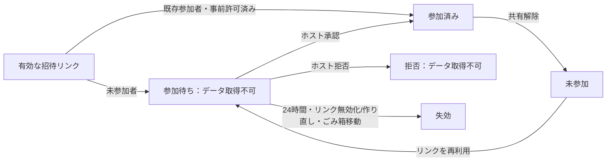

# 0.39.0：招待リンクの参加承認

2026-10-24。招待リンクの流出や、共有解除されたアカウントの再参加によって、ホストが意図しない相手に作品が見えるリスクを抑える。

## 使い方

1. ホストが従来どおり「クラウド」→「共有管理」で招待リンクを作る。
2. 相手がリンクを開いてGoogleでサインインすると、参加申請が作られる。相手の画面は「ホストの承認を待っています」となり、作品本体は取得できない。
3. ホストの「共有管理」の先頭に「参加待ち」が表示される。Googleで確認した氏名・メールアドレスを見て、次から選ぶ。
   - 相手の横の「承認」で個別承認。
   - 複数のチェックを付け、「選択したアカウントを承認」。チェックしていない相手は参加待ちのまま。
   - 「全選択」して一括承認。
   - 不要な申請は個別・選択一括で拒否。
4. 承認された相手は作品を開ける。最初の権限は閲覧・付箋コメントのみ。編集権限は既存の共有管理から設定する。

作品一覧のカードにも参加待ち人数を表示し、そこから対象作品の共有管理へ移れる。表示中は約5秒ごとに更新し、手動更新も可能。申請した側は再読み込み後も承認待ちへ戻れる。待機画面を閉じて別の作業をしている間は、勝手に作品を切り替えない。

**承認すると作品全体の閲覧・保存が可能になる。行・列の編集制限は閲覧制限ではない。** Googleの表示名だけを信用せず、メールアドレスも確認する。

## 既存利用者との関係

- 既存の参加者は自動では解除しない。すでに流出したリンクで参加した人が疑われる場合は、ホストが既存メンバーも確認・解除する必要がある。
- ホストが事前共有したメールアドレスは、すでに参加を許可したものとして扱う。Google認証済みメールが一致した本人に、既存の編集範囲を適用する。追加の承認は不要。
- 共有を解除した人が有効な招待リンクを使い直しても、新しい参加申請になる。古い承認の再送で復帰できない。
- 旧フロントエンドが従来の「参加」APIを直接呼んでも、未承認の相手はメンバーにならない。新しい画面を使うには再読み込みが必要。
- 今回は招待の承認制に限定した改善。以前ダウンロードされたファイルの回収、端末キャッシュの消去、行・列ごとの閲覧制御、写真メタデータ除去は追加していない。

## 状態と有効期限

申請は24時間有効。リンクを作り直す／無効化すると未承認・拒否済みの申請を失効させる。承認済みメンバーのアクセスはリンク無効化だけでは削除しない。

同じアカウントの同じ作品への申請は重複作成せず、再読み込みや再送でも元の申請に戻す。拒否された相手は同じリンク・有効期間内に勝手に参加待ちへ戻れない。新しいリンクから再申請しても、閲覧には再承認が必要。1作品につき有効な未承認・拒否申請は100件までとし、既存のリクエスト数制限も維持する。

有効期限はアクセス判定の期限であり、申請レコードの厳密な物理削除時刻の保証ではない。期限切れ行は新しい申請の処理時にも整理する。画像・作品・バックアップの保管期間は今回変えていない。

## 実装とアクセス制御

- Node・Cloudflareに同じ`join_requests`テーブルと索引を追加。既存の作品・共有・安定した行列IDは書き換えない。Cloudflareの既存Durable Objectクラスを維持し、起動時に追加テーブルを作る。
- `src/joinRequests.ts`の共通ロジックを両バックエンドで使用。作品への`members`登録は承認時だけ行う。参加待ちを権限「閲覧のみ」のメンバーとして扱わない。
- 承認・拒否はホストを確認し、本文取得後にも作品へのアクセスを再検証。全IDの所属・状態・有効期限・現在の招待を先に検証し、1つでも不正なら一括操作全体を拒否する。
- 検証とメンバー追加・申請更新を同じSQLiteトランザクションで確定する。承認の再送は重複登録しない。共有解除で承認レコードも破棄し、古い承認の再送を拒否する。
- 申請状況の照会は、申請者本人に限定する。他人の申請IDでは作品ID・氏名・メールを返さない。ホスト向けの一覧も、その作品のホストだけが取得できる。
- 承認前は作品IDを参加応答へ返さず、WebSocket・画像・付箋・履歴等は既存の参加確認で拒否。直接作品URLを知っていても参加できない。
- 本人用の申請IDはURLに保持して再読み込みへ対応。承認前に招待トークンをURLから除き、作品を開いた後は通常の作品URLへ置き換える。申請ID自体はアクセス権を付与する秘密リンクではない。
- 参加待ちはJSON・完全バックアップ・保存した版に含めない。復元時に古い参加待ちを自動的に承認することはない。

| API                                         | 権限・動作                                                                               |
| ------------------------------------------- | ---------------------------------------------------------------------------------------- |
| `POST /api/invites/:token/accept`           | 認証必須。未参加者は202と`pending/requestId`。既存の許可済み参加者は200と`approved/id`   |
| `GET /api/join-requests/:requestId`         | 本人だけが状況を照会。承認されるまで作品IDや他者の情報を返さない                         |
| `GET /api/decks/:id/join-requests`          | ホストだけが有効な参加待ちの氏名・メール・日時・申請IDを取得                             |
| `POST /api/decks/:id/join-requests/approve` | ホストだけ。`{requestIds: [...]}`、1〜100件、同一作品に限定。単一・複数・全選択は同じAPI |
| `POST /api/decks/:id/join-requests/reject`  | ホストだけ。同じ選択形式で拒否                                                           |
| `GET /api/decks`の追加項目                  | ホストの作品だけに`pendingRequests`人数。一般参加者に申請者情報は配布しない              |

主な変更：`src/joinRequests.ts`、`JoinRequests.tsx`、`cloud.ts`、`CloudPanel.tsx`、`SharingManager.tsx`、`style.css`、`server/app.ts`、`cloudflare/directory.ts`・`common.ts`。更新履歴とバージョンは0.39.0へ更新した。

## 検証

Linux Chromiumのdesktop/touch設定による独立したテスト環境で確認。実生徒のアカウント・公開ルームは使っていない。[ログと画面例](audit-evidence/invitation-approval-2026-10-24/)を保存した。

| 検証                             | 結果                                                                                                                                                                                                 |
| -------------------------------- | ---------------------------------------------------------------------------------------------------------------------------------------------------------------------------------------------------- |
| `npm test`                       | 単体91件・Node API15件成功。重複申請、24時間失効、100件上限、一括処理の全体検証・ロールバック、拒否、承認再送、共有解除後の古い承認拒否を含む                                                        |
| `npm run test:cloudflare`        | 型検査・dry-runと20件成功。既存の認証・40人同期・バックアップ障害注入A/B/Cと、新しい承認APIを含む                                                                                                    |
| Node共同編集ブラウザー全体       | 30件成功。既存の招待シナリオもホスト承認を明示する形に更新                                                                                                                                           |
| Cloudflare共同編集ブラウザー全体 | 同じ30件成功。Miniflareの独立したRoom/Directoryを使用                                                                                                                                                |
| 最終ビルドでの重点ブラウザー試験 | Node4件・Cloudflare4件成功。個別／選択／全選択承認、未選択者の拒否維持、非ホストの承認拒否、共有解除後の再申請、再読み込み、画面を閉じた後の遅延応答を確認                                           |
| 以前のプライバシー監査スクリプト | 両バックエンドで、リンクだけでの閲覧と共有解除後の自動再参加を拒否することを確認。ブラウザーでは明示的なホスト承認後だけ閲覧・JSON保存できることを確認。他の既知のキャッシュ等の指摘も残ることを記録 |
| 視覚確認                         | 架空の児童A/B/Cを用いて1366×768と1024×768で確認。ホスト3件中2件選択、作品カードの申請人数、申請者の待機画面を撮影。横あふれなし                                                                      |

全体ブラウザー試験後に待機画面の不要な一覧を外し、閉じた後の応答処理を調整した。その最終ビルドで承認と待機画面の重点試験を再実行した。重点試験は全体試験と一部重複するため、独立した機能数として合算しない。Viteの500kB超チャンク警告は残る。

実行例：`npm run test:cloud -- --grep 'host approves only|a delayed pending'`、Cloudflareは`npm run test:cloudflare:e2e`に同じgrepを指定。新しいAPIの共通試験は`tests/support/join-approval-features.ts`、状態管理の単体試験は`src/joinRequests.test.ts`。本番ビルド・Node型検査も成功。

[ホストの参加待ち画面](audit-evidence/invitation-approval-2026-10-24/host-requests.png) ／ [申請者の待機画面](audit-evidence/invitation-approval-2026-10-24/student-waiting.png) ／ [作品一覧の参加待ち人数](audit-evidence/invitation-approval-2026-10-24/library-request-count.png)

実Chromebook・iPad/Safari・実Google Workspaceのログイン設定は未検証。本番の生徒データにはアクセスせず、本番へのデプロイはしていない。
