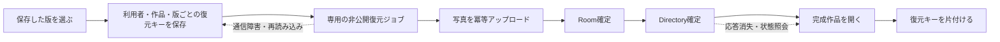

# 担当・比較・発表ルート・保存した版（0.38.0〜）

2026-10-24。[実装計画](priority-features-plan.md)の優先度「最優先」「高」の5機能。0.38.1では機能の入口を目的別に整理した。担当はフィルタ、比較はマップ、PDFと保存した版は保存メニュー、ルートは発表メニュー、ごみ箱はクラウド作品一覧から利用する。[UIの変更点と検証](workflow-ux.md)を参照。以下の検証・公開記録は0.38.0時点のもの。

## 利用方法

| 機能               | 操作と動作                                                                                                                                                                                                                                            |
| ------------------ | ----------------------------------------------------------------------------------------------------------------------------------------------------------------------------------------------------------------------------------------------------- |
| 自分の担当         | マップの「フィルタ」→「自分の担当を選択」から、現在のシートの担当を選び、適用する。シートの切り替えは既存のシートタブを使う。行列の安定IDに紐づく既存権限を使用。ホスト・全編集者は全ページが対象、閲覧専用は担当なし                                 |
| 比較表示           | マップの「比較」で現在のシート／現在のフィルタ／作品全体を選び、最大4枚を並べて表示。選択・比較によってスライドの位置や内容は変わらない                                                                                                               |
| PDF                | 保存の隣の▼→「PDFで保存」で範囲を選び、「PDFの準備」→「印刷・PDFに保存」。ブラウザーの印刷画面でPDF保存を選ぶ。16:9・1スライド1ページ。背景のグラフィックを有効にする。フォントと画像の読み込みを待ち、壊れた画像がある場合は印刷ボタンを有効にしない |
| 発表ルート         | 選択した順に名前を付けて保存。上下ボタンで順番を変え、不要なページを外せる。複数シートにまたがるルートも保存可能。ルート発表の左右／上下は前後へ進む。通常の縦横発表も維持。削除済みや重複した参照はスキップ                                          |
| ごみ箱・保存した版 | 手動保存、スライド・シートの削除前、変更時に最大5分に1度の自動保存。保存した版を確認して別作品へ復元。クラウドでは写真と付箋も復元し、共有権限は引き継がない。作品一覧の削除はごみ箱へ移動し、戻す操作・確認付きの完全削除を提供                      |

PDFはブラウザーの印刷を利用する実装であり、PDFファイルをアプリ独自のエンジンで直接生成してダウンロードする方式ではない。印刷設定・用紙対応はブラウザーとOSに依存する。

## 保存構造と権限

### 発表ルート

`Deck.routes?: { id: string; name: string; slides: string[] }[]`を追加。version 1のJSONを維持し、ルートのない既存ファイルも読み込む。最大30ルート、名前80文字、各1000参照。座標ではなく安定したスライドIDで指定する。

Yjsの独立した`routes`ルートMapを使用し、ルート単位で更新する。JSON・共有・完全バックアップで保持する。クラウドでの変更はホストだけに許可し、UIに加えて`assertDeckAccess`と`applyAuthorizedUpdate`でNode／Cloudflare双方が拒否する。発表と比較は閲覧者も利用できる。

### 版の保存

- Node：同じSQLiteに`work_history`（一覧）と`work_history_parts`（本文）を追加。
- Cloudflare：各SlideRoomのSQLiteに同じ2テーブルを追加。Directoryはホストを確認してRoomへ転送し、応答前にも権限を確認する。
- 自動保存は更新・削除する前のスナップショットを、対象のスライド更新と同じSQLトランザクションに保存する。履歴保存に失敗した場合、当該更新もACKしない。既存の未送信データ保護を維持する。
- 端末：IndexedDBの`vhslide-history/versions`を使用。削除前の保存に失敗した場合は削除しない。保存中に作品が変わった場合、古い削除操作を後から適用せず再操作を案内する。
- 最大10版・20MB。クラウドは作品ごと、端末はブラウザー内の共通履歴で管理する。1版最大12MB。20MBはスナップショットJSONのUTF-8量であり、画像・SQLiteの索引や内部領域は含まない。期限による自動完全削除は行わない。
- 本文は分割して保存し、絵文字などのサロゲートペアの途中で切らない。保存順は同一時刻でも単調に進め、保持上限で新しい版が消えないようにする。
- 写真は現在と同じ認証付きの画像参照で保持し、版ごとには複製しない。現在の実装ではスライドから外した画像も作品内に残るため、保存した版から参照できる。将来、画像の容量回収を追加する場合は履歴からの参照も保護する必要がある。
- 付箋は保存した時点の本文・配置・色・サイズ・投稿者名を含む。コメントの削除・要素の削除を一操作ずつ永久保存する仕組みではない。削除前の強制保存はスライド／シート単位で、通常の「元に戻す」は従来どおり自分の変更だけが対象。
- 過去版を現在の共同編集ドキュメントへ上書きしない。クラウドは専用の新規作品へ写真・付箋・ルートを復元し、共有設定は常にOFF。端末は現在の作品も履歴へ退避してから復元した複製を開く。端末にクラウドのような独立した作品ライブラリーが増えるわけではない。

### 復元の再試行と新しいコピー

既存の完全バックアップの既定動作は変更しない。同じファイル・共有設定の再試行は同じジョブへ戻る。

過去版から利用者が新たに復元を指示する場合は`newCopy: true`と永続的な冪等キーを使用する。同じ復元操作の通信再試行・再読み込みは同じキーで再開し、成功して開き終わったらキーを片付ける。次の意図的な復元では新しいキーを発行し、以前の復元先が編集済みでも新たな作品へ復元する。

復元中に中断しても元作品を削除せず、未完了ジョブは従来のバックアップ画面から確認・取り消しできる。元の版が保持されている間は同じ版からの操作でも再試行できる。保存上限でその版が整理された場合や元作品を完全削除した場合に備えて、重要な時点は引き続き完全バックアップZIPも保存する。

### クラウド作品のごみ箱

両バックエンドに`work_trash`を追加。通常の作品一覧から除外し、所有者だけがごみ箱の一覧・復帰・完全削除を操作する。スライド・画像・見出し・共有・履歴APIと新規接続を止め、既存WebSocketも閉じる。Cloudflareの内部認可でもごみ箱を確認する。

復帰は元の作品IDと共有メンバーの権限を維持する。そのため、元の共有メンバーも再び開ける。既存の招待トークンはごみ箱へ移動する際に破棄し、復帰しても再利用しない。復帰と完全削除はクラウド側でも順序を保護し、復元完了済み作品を「失敗した復元」として自動的に削除しない。

ごみ箱内も作品数・画像容量に含める。自動的に完全削除しないため、容量を空けるには所有者が確認して完全削除する。完全削除では写真・版も削除し、後から復帰できない。完全削除の開始前に永続的な`purging`状態を記録し、写真やRoomの削除後に処理が失敗しても「作品一覧に戻す」は拒否する。再起動後も完全削除を再試行できる。既存の2列のごみ箱テーブルには起動時に列を追加する。

互換性のため既存の`DELETE /api/decks/:id`は完全削除APIとして残している。新しい通常UIは`POST /trash`を利用する。旧版の画面や外部のAPI利用者は完全削除APIの意味に注意する。

## API

すべて認証が必要。変更操作は既存のOrigin検証・レート制限の対象。

| API                                            | 意味                                                   |
| ---------------------------------------------- | ------------------------------------------------------ |
| `GET /api/decks/:id/history`                   | ホスト用の版一覧                                       |
| `POST /api/decks/:id/history` `{label}`        | ホストによる手動保存                                   |
| `GET /api/decks/:id/history/:version`          | ホスト用の保存スナップショット。共有設定は空           |
| `GET /api/trash`                               | 自分が所有するごみ箱の一覧                             |
| `POST /api/decks/:id/trash`                    | 完成作品をごみ箱へ。途中の復元ジョブの取り消しとは区別 |
| `POST /api/decks/:id/untrash`                  | 所有者による復帰                                       |
| `DELETE /api/decks/:id`                        | 確認済みの完全削除。旧API互換                          |
| `POST /api/restores` 追加の`newCopy?: boolean` | 過去版の意図的なコピー作成。未指定時の既存仕様は維持   |

## 主な変更ファイル

- UI：`src/SlideActionDialog.tsx`（0.38.0では`ToolsDialog.tsx`）、`src/HistoryPanel.tsx`、`src/CloudTrash.tsx`、`src/App.tsx`、`src/CloudPanel.tsx`、`src/PresentationView.tsx`、`src/style.css`。
- データ・権限：`src/model.ts`、`src/sharedDeck.ts`、`src/permissions.ts`、`src/learningTools.ts`、`src/cloud.ts`、`docs/deck.schema.json`。
- 保存・復元：`src/historyStore.ts`、`src/localHistory.ts`、`src/backupClient.ts`、`server/app.ts`、`cloudflare/directory.ts`、`cloudflare/room.ts`。
- 検証：`src/learningTools.test.ts`、`tests/support/learning-features.ts`、`tests/server/app.test.ts`、`tests/cloudflare/worker.test.ts`、`tests/e2e/learning-tools.spec.ts`、`tests/cloud/collaboration.spec.ts`。
- バージョン：`package.json`、`package-lock.json`、`src/releaseHistory.ts`。

## 検証結果

Linux（Debian GNU/Linux 13）・Node v24.19.0・Chromium 154.0.8037.57でのローカル試験。公開ルームは使用していない。詳細ログは[証跡](audit-evidence/learning-tools-2026-10-24/)に保存。

| 検証                                       | 結果・範囲                                                                                                                                                                                                                                                                |
| ------------------------------------------ | ------------------------------------------------------------------------------------------------------------------------------------------------------------------------------------------------------------------------------------------------------------------------- |
| `npm test`                                 | 単体87件、Node API14件成功。安定IDの担当・ルートのJSON/Yjs/バックアップ保持・非ホスト更新拒否、版の保持件数と実バイト上限・絵文字・保存失敗時のトランザクション取消しを含む                                                                                               |
| `npm run build`                            | フロント・Node型検査と本番ビルド成功。メインJSが500kBを超えるVite警告は残る                                                                                                                                                                                               |
| `npm run test:cloudflare`                  | Cloudflare型検査・dry-runと19件成功。40接続、既存の障害注入A/B/C、版／ごみ箱の再起動・認可、Room削除後のDirectory障害と再試行を含む                                                                                                                                       |
| 本番ビルドでのローカル全体ブラウザー試験   | 176件中139件成功・37件は端末条件等により対象外。失敗0件                                                                                                                                                                                                                   |
| 最終追加・変更箇所のローカルブラウザー試験 | 22件中21件成功・1件対象外。新しい容量不足の故障注入をdesktop/touchで成功。保存失敗時には削除せず、保存機能が回復した後の再操作で削除できる                                                                                                                                |
| Node共同編集ブラウザー試験                 | 28件すべて成功（desktop/touch）。未送信データ、既存の共有・付箋、ZIP復元、担当・ルート権限、ごみ箱、版からの再開・複数回の復元を確認                                                                                                                                      |
| Cloudflare共同編集ブラウザー試験           | 28件すべて成功（desktop/touch）。既存の共同編集・権限・完全バックアップと新機能を、Miniflareの独立したRoom/Directoryで確認                                                                                                                                                |
| PDFの実ファイル確認                        | Chromiumの印刷から2ページのPDFを生成。`pdftotext`で内容、`pdftoppm`で描画を確認。16:9に相当するページ寸法（丸めを含む720×404.88pt）。[PDF](audit-evidence/learning-tools-2026-10-24/comparison.pdf)・[描画見本](audit-evidence/learning-tools-2026-10-24/pdf-preview.png) |

ブラウザー試験の件数は同じ試験の再実行を含むため、合計して独立した機能数とはしない。本番ビルドのプレビューで試験し、開発サーバーのHMRによる試験途中のリロードを避けた。`npm run test:e2e:preview -- --workers 1`を追加して再現可能にした。ローカル単体画面の試験ではクラウドAPIを起動せず、`/api/config`の接続拒否ログが出る。これはオフライン時のローカル動作を試す構成であり、共同編集試験は別の認証付きテストサーバーを使う。

今回の試験で発見・修正した事項：狭い画面でのヘッダーボタンの横あふれ、暗号UUID APIがない端末でのローカル版保存、保存完了前に削除を実行する競合、サロゲートペアの分割、同時刻の版の保持順、過去版の再復元で以前の編集済みコピーを再利用してしまう問題、完全削除の部分失敗後に不完全な作品を復帰できてしまう問題。旧ブラウザー試験も、削除前の永続保存を待つ条件と、不正ZIP読み込みの完了を待つ条件へ修正した。

## 残る確認事項

- 実Chromebook、実iPad/Safari、Windows実機でのタップ・印刷ダイアログ・メモリ使用量は未検証。ブラウザーテストのtouch設定はChromiumによる代替。
- 1000枚を同時にPDF化する際の時間・メモリは未測定。通常のマップは既存の仮想化を維持するが、印刷時には選択した全ページを準備するため別途検証が必要。
- バックアップ・版・ごみ箱は保護の範囲が異なる。保持上限を超えた古い版、完全削除した作品、保存しなかった直前のすべての操作を取り戻せるわけではない。
- クラウドの履歴上限は作品ごと（端末は共通履歴）であり、クラウド全体の無料枠や従量課金の停止を保証するものではない。長期運用の容量・SQL書き込み量・負荷検証は別途必要。
- 本番環境・公開ルームでの編集テストは行っていない。実装時は未デプロイだったが、2026-10-24に利用者の指示で0.38.0を公開した。公開後はhealth・設定API・静的配信のみ確認し、作品データは変更していない。

## 公開記録（2026-10-24）

利用者の明示的な依頼によりCloudflareへ0.38.0を公開。Version ID：`549dda9e-2d4a-4b7a-bc0b-7570b9e43f42`。本番ビルド・Cloudflare型検査後、`npm run cf:deploy`が成功した。`/healthz`、`/api/config`、トップページ、新しいメインJSと更新履歴JSがHTTP 200で応答し、公開されたJSの内容が検証済みのローカルビルドと一致することを確認した。認証付き本番ルームにはアクセスしていない。ログは同じ証跡ディレクトリーの`deploy.log`と`deploy-verification.json`を参照。
