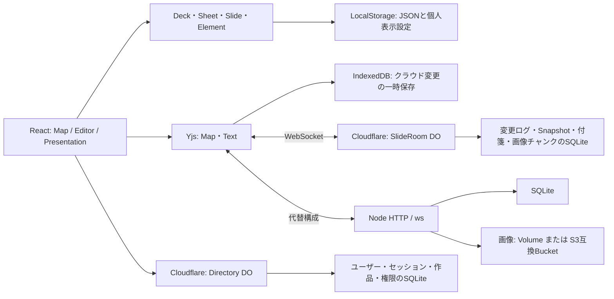

VHSlide（Matlidea）実装監査・競合比較調査

- 調査日：2026年10月23日（日本時間）
- 対象：`overdozer1124/VHSlide`、コミット `aee3108bd57e7e039a22bd67b0bbd85ff09b062f`、アプリ版 `0.36.0`。
- 検討名称：**Matlidea（マトライディア）**。Matrix × Slide × Idea。名称変更は実装していない。
- 製品コンセプト：「スライドを、線から面へ。アイデアを、次の次元へ。」
- 作業範囲：リポジトリの実装・設定・テスト・文書の静的調査、独立したローカル検証、公開URLの未認証・読み取り確認、取得可能な競合公式資料の調査。
- **アプリのソース、既存テスト、設定、依存関係は変更していない。共有ルームのデータ変更、デプロイ、新機能実装も行っていない。** 本報告書だけを作成した。

## 1. エグゼクティブサマリー

### 結論

VHSlideは、固定グリッドでスライドを構造化し、編集・俯瞰・共同作業を行う、実装の進んだプロトタイプである。単にスライドを縦横に表示するだけではなく、シート、視覚的フィルタ、行別の表示ページの記憶、行・列・個別スライドの権限、アカウントの一括割り当て、付箋、自己変更だけのクラウドUndoまで実装されている。[根拠：`src/model.ts`、`src/workbook.ts`、`src/permissions.ts`、`src/SharingManager.tsx`、`src/cloud.ts:329`。詳細は第2節]

ただし、**「2次元スライド」「上下左右移動」「グリッド状の俯瞰」は、それだけで独自とは言えない。** reveal.js 6.0.2の公式コードには縦スタック、Overview、同じ縦位置を保って左右へ進むGridナビゲーションがある。Slides.comは同じ開発元によるGUIエディタとして公式READMEに案内されている。Matlideaが訴求すべきなのは、これらの発明ではなく、**授業における分担・比較・構造化・発表を一つの格子上で扱う体験**である。[競合根拠：C1～C4]

「縦横を対等に扱う」は現状では**部分的に成立**している。データは整数座標を持つが、右方向への追加は新しい列の先頭に入り、発表の左右移動は同じ行がなければ隣列の先頭へ移る。一方、編集時の上下移動には行ごとの記憶が使われる。保存できる任意の発表ルート、軸の意味を表す型、関係線や分岐グラフは実装されていない。[根拠：`src/model.ts:154` `insert()`、`:241` `rowPage()`、`:268` `editorNeighbor()`、`:636` `neighbor()`、`:48` `Deck`]

品質面では保存・認可の実装に具体的な保護がある一方、授業での運用前に整理すべき課題がある。特に、**行の並べ替えと座標ベースの編集権限の関係、付箋等を含まないJSONバックアップ、写真容量と書き出し上限の不一致、見出しメタデータの同時編集、実機の操作品質**が優先事項になる。今回、認証回避や永続化済みスライドの破損といったP0の重大不具合は再現していないが、完全なセキュリティ保証ではない。[根拠：第6・7節]

### 検証結果の要約

| 検証 | 今回の結果 | 解釈 |
| --- | --- | --- |
| `npm test` | 単体66件成功、Nodeバックエンド8件成功 | ロジック・認可・保存・40接続等の対象ケースを確認 |
| `npm run build` | 成功 | TypeScriptと本番ビルドが通る。約540kBの主JSチャンクにサイズ警告あり |
| `npm run test:cloudflare` | 7件成功 | Miniflare上でJWT検証、権限、写真、再起動復元、40 WebSocket等を確認 |
| 全ローカルE2E・専用サーバーで再実行 | **127件成功、37件スキップ、2件失敗** | 全件成功ではない。失敗2件は第5節に個別分析 |
| 失敗2件を1ワーカーで個別実行 | 1件成功、1件失敗 | 慣性入力は再実行成功。高さテストは期待値とシートタブの不整合を確認 |
| Cloudflare版クラウドUIのブラウザ検証 | **18件成功、失敗なし** | 本物のGoogleアカウントや公開ルームを使わず、独立したテスト用データで検証 |
| 公開URL | 現行アセット配信・ログイン画面・未認証の作品取得401を確認 | **認証済みのルーム本文・実Googleログイン・公開環境での共同編集は未確認** |
| 本番依存関係の`npm audit` | low 2件（Quillの1件の警告とy-quillへの波及）、high／critical 0件 | 脆弱性DBへの照会であり、アプリの安全性証明ではない |

### 比較調査の重要な制約

Slides.com／Prezi／Focuskyの公式Webサイト・ヘルプは、この環境のネットワーク制限でHTTP CONNECT 403となった。取得できた公式GitHub資料から確認できる事実は比較に用いたが、**Slides.com Arrange／Gridの最新UI・公開プランでの利用条件、Prezi／Focuskyの現行機能は未確認**である。「競合にない」「競合より使いやすい」「世界初」とする根拠は得られていない。第3節の未確認セルは、機能が存在しないという意味ではない。

## 2. VHSlideの構造と実装済み機能

### 2.1 技術・コンポーネント構成

| 領域 | 実装 | 根拠 |
| --- | --- | --- |
| フロントエンド | React 19、TypeScript 5.9系、Vite 7、Tailwind CSS 4のViteプラグイン、独自CSS、Lucide | `package.json`、`vite.config.ts:1`、`src/main.tsx:1`。Tailwindを導入しているが、UIの多くは`src/style.css`のクラス定義 |
| アプリ状態・画面 | `App`が作品、現在シート、ページ選択、map/editor/present、クラウド連携を統括 | `src/App.tsx:90`～`:221`。専用ルーターによる複数ページ構成ではなく、主に状態で切り替える |
| 全体マップ | `MapView`、`MapHeading`、`MapFilterPanel`、`MapZoomSettings`、`useMapTouchDrag` | `src/MapView.tsx:107`以降。固定グリッド、表示用の詰め直し、描画範囲制御 |
| 個別編集 | `Editor`、`Canvas`、`InlineText`／`CloudText`、`EditorPager`、`SlideRail` | `src/Editor.tsx:1`、`src/Canvas.tsx:56`、`src/EditorPager.tsx:10`、`src/SlideRail.tsx:73` |
| 発表 | `PresentationView`、方向ボタン、キー、タッチ、ミニマップ | `src/PresentationView.tsx:21`、`src/App.tsx:534`・`:847` |
| 共同編集 | Yjs 13、Quill 2、y-quill、独自WebSocketプロトコル | `src/sharedDeck.ts`、`src/cloud.ts:325`、`src/CloudText.tsx:22`。汎用y-websocketサーバーをそのまま使う構成ではない |
| ドラッグ | 編集一覧はdnd-kit、マップはHTML Drag and Dropと独自タッチ処理 | `src/RailDrag.tsx`、`src/useMapTouchDrag.ts`、`src/MapView.tsx:928` |
| クラウドUI | 中央モーダルの作品一覧・共有管理、一括設定、招待リンク | `src/CloudPanel.tsx:171`、`src/SharingManager.tsx:152` |
| テスト | Vitest、Node test runner、Playwright、Miniflare | `package.json`のscripts、`tests/`、`playwright*.config.ts` |

構造は明確な専用コンポーネントを持つ一方、`App.tsx`は1,310行、`MapView.tsx`は1,159行、`style.css`は4,865行、Nodeサーバーは1,192行、Cloudflare Directoryは806行ある。これは直ちに不具合ではないが、ジェスチャー・保存・権限の相互作用を追うコストが高い。CSSでは同じセレクタを後半で上書きする例もある。将来の分割は提案対象であり、本調査では実施していない。



### 2.2 バックエンドとデータベース

**現在のCloudflare構成はWorkers＋SQLite型Durable Objectsであり、R2・D1・KVのバインディングはない。** Directoryは`directory-v1`という一つのDO、SlideRoomは作品IDごとのDOである。画像はSlideRoomのSQLiteに64KiBチャンクで保存される。過去の会話で検討された構成と、現在の実装は区別する必要がある。[根拠：`wrangler.jsonc`、`cloudflare/common.ts:129`、`cloudflare/room.ts:33`～`:49`]

- Directory：`users`、`sessions`、`decks`、`members`、`grants`、`recipients`、`invites`、`assets`、`rates`。Google署名検証、参加資格、容量予約、一括アカウント設定を管理する。[`cloudflare/directory.ts:50`]
- SlideRoom：`meta`、`snapshot`、`updates`、`comments`、`assets`、`asset_chunks`。変更は永続化してからACKし、約200更新ごとにスナップショットへまとめる。[`cloudflare/room.ts:43`・`:70`・`:445`]
- Node代替：Node 24の`node:sqlite`、HTTP、`ws`。スライド・更新ログ・セッション等をSQLiteに持ち、画像はVolumeまたはS3互換ストレージ。Railway設定は1レプリカを指定する。[`server/app.ts:115`、`server/storage.ts:11`、`server/index.ts:1`、`railway.json`]
- 静的ホスティング時：クラウドAPIがなくてもローカル編集・JSON保存を利用する構成。ただし、サーバーなしで共同編集できるわけではない。[`src/cloud.ts:180`、`.github/workflows/pages.yml`]

| 制限 | コード上の値／条件 | 注意 |
| --- | --- | --- |
| スライド | 作品全体1000枚、各座標0～99、最大50シート | 100×100×50の全マスを埋められるという意味ではない |
| 編集要素 | 1枚200要素、テキスト1ボックス10000文字、文字サイズ12～120 | 各上限が同時に快適に使えることは未確認 |
| JSON | 最大25,000,000バイトの書き出し | `parseDeck()`単体の最初の検査は文字列長。ファイル入力側はバイト数も検査 |
| Cloudflare共有作品 | materialize後JSON 2MB、Yjs状態8MB | ローカル上限とは別。写真本体は別保存 |
| Cloudflare画像 | 1画像6MB、作成者ごと50MB、全体500MB | 作品内の削除だけで容量が戻る仕組みは確認できない |
| Cloudflare同時接続 | 作品ごと50 WebSocket、作成者ごと40作品 | 50アカウントではなく50接続。複数タブも消費 |
| Node | 既定全体200接続、作品50接続、作成者画像250MB等を環境変数で調整 | Cloudflareと同じ容量値ではない |

根拠：`src/model.ts:1`・`:448`、`cloudflare/room.ts:106`・`:350`、`cloudflare/directory.ts:34`・`:417`、`server/app.ts:151`、`.env.example`。Cloudflareの実契約プラン・請求額・現在の公式無料枠は本調査では再確認していない。容量制限は料金のハードキャップではない。

### 2.3 データモデル・保存・同期

代表的な作品構造は次のとおり。これは説明用の有効な最小例であり、公開ルームの実データではない。

```json
{
  "version": 1,
  "title": "考えを比較する",
  "sheets": [{ "id": "main", "name": "シート1", "rowLabels": { "0": "A班" }, "columnLabels": { "0": "問い" } }],
  "slides": [{ "id": "p1", "sheetId": "main", "x": 0, "y": 0, "title": "はじめ", "background": "#ffffff", "elements": [] }],
  "activeSheetId": "main",
  "rowSelections": ["p1"],
  "linkedRows": false
}
```

- スライド座標とスライド内の要素座標は別である。前者は固定マス、後者は960×540キャンバス内の自由な座標。`Canvas`という名称だが描画はHTML/CSSとSVGであり、HTML Canvasの描画APIではない。[`src/model.ts:3`～`:58`、`src/Canvas.tsx:6`・`:217`]
- `parseDeck()`が入力型、ID、セル重複、境界、画像URL、各シートの原点等を検査する。外部の任意HTMLや任意URLをそのまま描画する構成ではない。[`src/model.ts:448`～`:634`]
- ローカル編集はLocalStorageへ作品全体を自動保存し、容量不足時は通知する。破損した保存を読んだ場合は上書きを保留する。[`src/App.tsx:74`・`:511`]
- クラウド共有はY.Mapでスライド／要素、Y.Textで作品名・ページ名・テキストを管理する。位置は一つの`position`値、行／列見出しはシートのJSON値として保存する。[`src/sharedDeck.ts:17`・`:52`・`:102`]
- クラウドでは現在シート・行ごとの表示ページ・縦連動設定を利用者側に保持し、相手の表示選択を上書きしない。[`src/App.tsx:189`～`:212`、`src/cloud.ts:365`]
- 同期は変更をまとめて送る方式。クライアント初期値は100msだが、Cloudflareの`/api/config`は1000msを返す。**クラウドは完全な瞬時反映ではない。** 再接続ではstate vectorとの差分を送る。[`src/cloud.ts:165`・`:192`・`:390`・`:466`、`cloudflare/directory.ts:315`]
- IndexedDBのYjsキャッシュとLocalStorageの表示用作品JSONは別系統。キャッシュは未送信変更の復元を助けるが、公開アプリを完全オフラインで初回起動できるPWAを実装したものではない。Service Workerの登録は確認できない。[`src/cloudCache.ts`、`src/cloud.ts:310`・`:340`]
- クラウドの写真入りJSONは`portableDeck()`が画像を取得してdata URLへ埋め込む。認証・写真取得・容量上限の影響を受ける。付箋や共有相手・権限は`Deck`に含まれない。[`src/cloud.ts:53`、`src/App.tsx:759`、`src/permissions.ts:103`]

### 2.4 共同編集・認可の実装評価

**肯定できる点**：Google IDトークンの署名・audience・issuer・email_verifiedを検査し、HttpOnlyセッション、Origin検査、作品参加権限、写真の作品所属を確認する。Yjs更新は受信候補に適用して検証し、UIでボタンを無効にするだけではなくサーバー側で編集可能範囲を強制している。未解決CRDT更新や隠れた型への書き込みも検査対象である。[`cloudflare/directory.ts:84`・`:102`・`:345`、`cloudflare/index.ts:13`、`src/authorizeUpdate.ts:7`、`src/permissions.ts:80`]

クラウドUndoは`trackedOrigins: new Set([LOCAL_CHANGE, QuillBinding])`で自分の変更だけを追跡する。共有相手の更新は`"server"`として適用される。これは「全員の作品全体を古いJSONへ巻き戻す」方式ではない。ただし、自分が行った構造変更のUndoが、同じ対象への相手の後続変更に与える意味的影響までゼロになる保証ではない。[`src/cloud.ts:329`・`:394`]

**限界**：個々のテキスト・プロパティの統合と、授業上の所有・分担の保持は別である。同じプロパティの競合はYjs規則で一方に確定し、行・列権限は座標を参照する。第6節の再現例があるため、「共同編集ならどんな操作でも意味を保って統合される」とは評価しない。

### 2.5 機能判定一覧

判定は指定の5段階のみを用いる。「実装・動作確認済み」は今回のローカル自動操作等が通った範囲を意味し、全端末・全ケースでの保証ではない。コードだけの存在、公式資料だけの確認、実機未確認は区別する。

| 機能 | 判定 | 確認内容・限界 | 主な根拠 |
| --- | --- | --- | --- |
| 横・縦へのスライド追加 | 実装・動作確認済み | 右／下の＋、行・列間への挿入。右追加は新列先頭 | `model.ts:154`・`:173`、`App.tsx:775`、`tests/e2e/app.spec.ts:3`・`editor-grid.spec.ts:53` |
| 2次元配置・座標管理 | 実装・動作確認済み | 整数マス、重複検査、原点維持、最大1000枚 | `model.ts:448`、`model.test.ts`、`tests/cloudflare/worker.test.ts:178` |
| 全体俯瞰・ズーム | 実装・動作確認済み | グリッド、表示領域外の内容描画抑制、10～300%の段階設定、番号表示 | `MapView.tsx:107`・`:833`、`workspacePreferences.ts:24`、`map-viewport.spec.ts`・`workspace-display.spec.ts` |
| 個別／行／列で絞り込み | 実装・動作確認済み | 見出し・実カードで選択、平方根ベースで詰め直し。元の座標は変更しない | `mapFilter.ts:13`・`:56`、`MapView.tsx:124`、`direct-filter.spec.ts` |
| 編集画面の絞り込み維持 | 実装・動作確認済み | 対象スライドだけを一覧・キー・スワイプの対象にできる | `App.tsx:105`、`direct-filter.spec.ts:78` |
| マップのスライド・行・列移動 | 実装・動作確認済み | マウス移動、タッチ長押し。占有マスは入れ替え、個別ページの間は挿入 | `model.ts:209`・`:334`・`:342`、`useMapTouchDrag.ts`、`app.spec.ts:202`・`thumbnail-drops.spec.ts:161` |
| 編集一覧のドラッグ移動 | 実装・動作確認済み | 行全体・個別・行をまたぐ移動。挿入時の隣接移動表示 | `RailDrag.tsx`、`SlideRail.tsx`、`row-thumbnail-drops.spec.ts`・`thumbnail-drops.spec.ts:82` |
| 行単位の一括複製・削除 | 実装・動作確認済み | 複製数1～99、全体枚数・100行制限、Undo | `model.ts:404`・`:428`、`sheets-filter.spec.ts:191` |
| ページ・行のメニュー | 実装・動作確認済み | 右クリック、メニューボタン、キーボードで複製・削除等 | `ThumbnailMenu.tsx`、`thumbnail-actions.spec.ts` |
| 独立したシート | 実装・動作確認済み | 追加・複製・削除・改名・並べ替え、最大50枚 | `workbook.ts:46`、`SheetTabs.tsx`、`sheet-tabs.spec.ts`・`sheets-filter.spec.ts:122` |
| 編集中の上下左右移動 | 実装・動作確認済み | 行の表示選択を記憶、縦連動切り替え、矢印キー | `model.ts:241`・`:268`、`App.tsx:315`・`:380`、`editor-interactions.spec.ts` |
| テキストの直接入力・基本書式 | 実装・動作確認済み | 直接入力、サイズ、太字、色、ハイライト、箇条書き、左右×上下の9通り | `InlineText.tsx`、`CloudText.tsx`、`Editor.tsx:409`、`text-alignment.spec.ts` |
| Googleスライド相当のリッチテキスト | 部分実装 | 書式はテキストボックス単位。Quillは`formats: []`。選択した数文字だけの書式や複数フォント等はない | `CloudText.tsx:24`、`model.ts:11`、`Canvas.tsx:264` |
| 画像の追加・復元 | 実装・動作確認済み | ファイル・貼り付け・ドロップ、サイズ調整、JSON画像埋め込み | `App.tsx:616`・`:674`、`Canvas.tsx:18`、`app.spec.ts:134`、クラウドブラウザ検証 |
| 図形・要素移動・リサイズ・重なり | 実装・動作確認済み | 四角・角丸・丸・矢印・吹き出し。中央スナップ、前後順 | `Canvas.tsx:27`・`:159`、`Editor.tsx`、`app.spec.ts:3`・`editor-interactions.spec.ts` |
| 高度なレイアウト編集 | 部分実装 | 中央ガイド等はあるが、多選択・グループ化・回転・画像トリミング・均等分布のUI/データ項目は確認できない | `Canvas.tsx:95`・`:159`、`model.ts:11`、`Editor.tsx` |
| 発表モード | 実装・動作確認済み | 現在シートの原点開始、4方向キー・ボタン・タッチ、全画面要求、方向別アニメーション | `App.tsx:847`・`:555`、`PresentationView.tsx`、`app.spec.ts:3`・`:257` |
| 発表時の現在地表示 | 実装・動作確認済み | ミニマップはあるが、操作HUDと一緒に自動で隠れる。セルはボタンではなく`span` | `PresentationView.tsx:146`、`style.css:2878`、`workspace-display.spec.ts` |
| 任意の発表ルート保存 | 未実装 | 矢印で動けることと、複数ルートを命名・保存・再生することは別 | `Deck`・`neighbor()`、`PresentationView.tsx`の全定義を確認 |
| タッチの指追随とピンチ遷移 | 実装・動作確認済み | 要素上からのページ移動、途中位置追随、マップ↔編集、段階ズーム | `useSlidePan.ts`、`usePinch.ts`、`WorkspaceTransition.tsx`、`editor-swipe.spec.ts`・`workspace-pinch.spec.ts` |
| Windows／ChromeOS実機のタッチパッド品質 | 実装済み・動作未確認 | wheel処理はあるが、実デバイスは未使用。合成Windows慣性テストに一括時の失敗あり | `useSlidePan.ts`、`editor-swipe.spec.ts:342`、第5節 |
| クラウド同期・再接続・自己Undo | 実装・動作確認済み | 独立テスト内の複数クライアント、同一テキスト、切断・再接続、再起動 | `cloud.ts:325`～`:477`、`sharedDeck.ts`、`tests/server/app.test.ts:260`、`tests/cloud/collaboration.spec.ts:138` |
| 実Googleアカウントでの認証 | 実装済み・動作未確認 | 検証ロジック・テストJWTは確認。実Google OAuth／Workspace管理設定は未確認 | `cloudflare/directory.ts:345`、`server/app.ts`、`tests/cloudflare/harness.ts` |
| URL招待・事前アカウント共有 | 実装・動作確認済み | ローカルテストで署名済みIDによる参加、順番の行割り当て、参加停止を確認 | `PreSharePanel.tsx`、`preSharing.ts`、`tests/cloud/collaboration.spec.ts:521` |
| 行・列・1枚単位の編集権限 | 実装・動作確認済み | UIとサーバーで強制。設定・他人の付箋等を無断変更できないテストあり | `permissions.ts`、`authorizeUpdate.ts`、`PermissionPicker.tsx`、`tests/cloudflare/worker.test.ts:388` |
| クラウド作品・一括共有管理 | 実装・動作確認済み | カード・検索・絞り込み、複数選択の共通権限・行割り当て・解除と途中失敗 | `CloudPanel.tsx`、`SharingManager.tsx:152`、`tests/cloud/collaboration.spec.ts:971` |
| 付箋 | 実装・動作確認済み | 直接入力・自動保存・移動・色・サイズ・再試行。クラウドコメントとして別保存 | `SlideComments.tsx:18`・`:155`、`cloud.ts:119`、クラウドブラウザ検証 |
| ローカルJSON入出力・保存復元 | 実装・動作確認済み | 不正入力の拒否、リロード、画像埋め込みを確認 | `App.tsx:736`・`:759`・`:511`、`model.ts:448`、`app.spec.ts` |
| 作品全体の完全バックアップ／履歴復元 | 部分実装 | スライドJSONはあるが付箋・共有権限・過去版復元・ごみ箱は含まれない | `Deck`、`SlideComment`、`App.tsx:759`、`cloudflare/room.ts:95` |
| PDF／PPTX出力・Google Drive保存・AI生成 | 未実装 | 当該UI/API/モデルを本リポジトリで確認できない。ブラウザ印刷操作は専用PDF出力とは扱わない | `App.tsx:759`、`model.ts`、`server/app.ts`・`cloudflare/directory.ts`のルート、`package.json` |
| 実端末のSafari・スクリーンリーダー・WCAG適合 | 判定不能 | ChromiumのタッチエミュレーションをiPad Safariの実機検証とみなさない | `playwright.config.ts`・`playwright.cloud.config.ts`のChromium指定 |

この表でディレクトリを省略したTS/TSXファイルは`src/`配下、`*.spec.ts`は文脈に応じて`tests/e2e/`または明記した`tests/cloud/`配下である。

## 3. 競合サービスとの比較

### 3.1 根拠のある比較表

「公式資料確認」は競合を操作したことを意味しない。サービスとライブラリでは責任範囲が異なるため、reveal.jsやimpress.jsの本体にないクラウド機能を、その周辺サービス全体にないと一般化しない。

| 観点 | VHSlide 0.36.0 | Slides.com | reveal.js 6.0.2 | Prezi | Focusky | impress.js |
| --- | --- | --- | --- | --- | --- | --- |
| 基本構造 | 整数`(sheetId,x,y)`の固定格子 | reveal.jsのGUIエディタとして公式案内。現行内部構造は未確認 [C1] | 横のsectionと縦の入れ子section [C2,C4] | 現行公式本文未確認 [C7] | 現行公式本文未確認 [C8] | CSS変形とx/y/z/回転/scaleを持つ空間配置 [C9] |
| 上下左右移動 | 編集・発表に存在。疎な配置での規則に非対称性あり | 現行Grid設定画面・条件は未確認 | default/linear/grid。Gridは左右移動時に縦indexを維持 [C2] | 未確認 | 未確認 | goto等の移動API。固定格子の4方向とは異なる [C9] |
| 編集UI | 日本語の固定マップ＋要素エディタ、シート、タッチ | ビジュアルエディタの存在を確認。Arrange最新仕様は未確認 [C1,C5] | HTML/JSを作るフレームワーク。本体はGUI編集SaaSではない [C1] | 未確認 | 未確認 | HTML/CSS中心。READMEは別GUIプロジェクトを案内 [C9] |
| 全体俯瞰 | グリッド、番号表示、詰め直すフィルタ、ピンチ | Arrangeの最新操作・表示形式は未確認 | Overviewが縦横に配列する [C3] | 未確認 | 未確認 | 空間配置・移動を確認。固定格子の一覧UIは未確認 [C9] |
| 共同編集 | Yjs＋認証WebSocket、範囲別認可。ローカル検証済み | 今回取得した資料では同時編集の詳細未確認 | 本体のGUI共同編集サーバーは確認できない。外部拡張は対象外 | 未確認 | 未確認 | 本体の共同編集基盤は確認できない。外部拡張は対象外 |
| 共有 | Google登録・招待・事前アカウント・細粒度権限 | 公式Agent資料に公開URL・非公開共有リンク・失効操作 [C6] | HTMLを公開する形。認証・権限は別途用意 [C1] | 未確認 | 未確認 | HTML公開を前提としたフレームワーク [C9] |
| 発表・入出力 | 4方向、HUD、JSON。PDF/PPTX・発表者ノートはない | 公式Agent資料に発表者ノート、PDF/ZIP書き出し操作 [C6]。現行GUI・全プランは未確認 | キーボード、ノート、PDF、Markdown、コード、数式、Auto-Animate等 [C1,C2] | 未確認 | 未確認 | CSS 3D、複数プラグイン、IDによるジャンプ [C9] |
| AI | 未実装 | **公式MCP/AIクライアント連携を確認**。Lite/Pro/有効Teamが必要との記載。組み込み生成UIとは区別 [C5] | 本体のAI生成機能は確認できない。外部連携は未確認 | 最新仕様未確認 | 最新仕様未確認 | 本体のAI生成機能は確認できない |
| 使いやすさ | 基本フローは自動操作確認。児童ユーザーテスト・実端末評価は未実施 | 実操作未確認のため優劣を判定しない | コード編集の知識が必要な構成。学習コストの定量比較は未実施 | 未確認 | 未確認 | HTML/CSS知識が必要な構成。定量比較は未実施 |

Prezi／Focuskyについては公式サイトへの取得が失敗しているため、一般に知られたマーケティング説明を現行機能の確認結果として埋めていない。価格・無料枠・教育プラン・オフライン・共同編集・AIの有無も未確認である。

### 3.2 Slides.com Arrange／Gridの重点比較

**最初に区別するべき三つのもの**：

1. **配置編集**：スライドの順序や所属を変えるエディタの機能。
2. **発表ナビゲーション**：矢印を押したときの遷移規則。
3. **情報モデル**：行・列が何を表し、権限・担当者・比較軸とどう結びつくか。

依頼で挙げられたArrangeとGridを同じ「2次元機能」として一括比較するのは適切でない。Arrange／GridというSlides.comの名称は比較対象として受け止めるが、**その現行UIを本調査で操作・公式本文確認したとは主張しない。** reveal.jsのGrid実装をSlides.com GUIの現行仕様の証拠に代用することもしない。

| 比較テーマ | VHSlideで確認したこと | 競合側で確認できたこと／未確認 | 現時点の評価 |
| --- | --- | --- | --- |
| 配置を俯瞰し並べ替える | MapViewで内容を見ながら移動、入れ替え、挿入。行単位の操作もある | Slides.com Arrangeの最新機能範囲は未確認。公式Agentには`move_slides`操作の記述がある [C6] | 並べ替えそのものを独自とは主張しない |
| 同じ行を維持して横移動 | 発表時`neighbor()`は同じyを優先。なければ隣列先頭へ移る | reveal.js Gridは縦index維持を明記 [C2]。Slides.comでの設定条件は未確認 | 近い発表挙動は既存。これだけでは差別化にならない |
| 横・縦の対等性 | 固定座標だが追加・疎な配置・行記憶の挙動は対称ではない | reveal.jsは横section＋縦stackの階層 [C4]。Slides.comのデータ構造は未確認 | 「完全な対等性を既に実現」とは言えない |
| 行を担当者、列を問いとして使う | 見出し、担当者表示、行/列/個別権限、メール貼り付けの順次行割り当て | Slides.comに同等機能があるかは未確認 | Matlideaの有力な訴求候補。ただし競合不在は未証明 |
| 絞り込み後の表示と編集 | 選択ページを偏りの少ない格子へ再配置し、その集合を編集一覧に維持できる | Slides.com Arrangeの同等機能は未確認 | 実装済みの体験上の特徴として説明可能 |
| 俯瞰と編集の連続性 | ピンチによる相互遷移、選択サムネイルへの復帰、指追随 | Slides.com／Prezi／Focuskyの同等操作は未確認 | 実装の特徴とは言えるが、使いやすさの優位はユーザーテストが必要 |

**追加の比較調査で必要な操作**：同じ10列×40行相当の資料を準備し、Arrangeで行／列の意味を維持して並べ替えられるか、Gridで欠けたセルをどう扱うか、俯瞰から編集へ何操作か、児童アカウントに同じ範囲制限を付けられるか、プラン・端末別に同じ条件で確かめる。これらは今後の調査手順であり、今回完了した検証ではない。

## 4. VHSlideの強み・弱み

### 強み

- **構造と分担を同じ画面で扱える**：見出しとアカウント表示、座標ベースの範囲制限が連動する。授業で「誰が、どの問いについて作るか」を視覚化できる。[`MapView.tsx:754`、`ThumbnailFooter.tsx:4`、`Editor.tsx:315`、`permissions.ts:60`]
- **アカウントなしのローカル編集とJSONの可搬性**：クラウド障害と切り離して基本編集でき、アプリ固有サーバーなしの静的配信も用意される。ただし初回の完全オフライン起動や付箋込みの可搬性とは別。[`App.tsx:74`・`:759`、`cloud.ts:180`]
- **授業準備を省力化するまとまりがある**：シート複製、行の複数回複製、アカウント貼り付け、順番の行割り当て、一括変更・解除。[`workbook.ts:46`、`model.ts:404`、`PreSharePanel.tsx:40`、`SharingManager.tsx:152`]
- **実装されたサーバー認可**：クライアントが改造されても保護範囲へのYjs更新を拒む設計とテストがある。安全性をUIの無効化だけに依存していない。[`authorizeUpdate.ts:7`、`permissions.test.ts`、`tests/cloudflare/worker.test.ts:388`]
- **大量スライドを意識した表示**：画面周辺だけスライド内容を描画し、番号表示・行番号ジャンプを用意する。[`MapView.tsx:833`、`SlideRail.tsx:456`、`map-viewport.spec.ts:120`]

### 弱み

- **デッキ編集ツールとしての表現力は基礎段階**：文字ごとの書式、フォント、複数選択、画像加工、音声・動画、発表者ノート、PDF/PPTX等が不足する。Googleスライド全体の代替と説明するのは過大。[`model.ts:11`、`CloudText.tsx:24`、`Editor.tsx`、`App.tsx:759`]
- **2次元情報モデルと発表ルートが未完成**：軸名は付けられるが、軸の役割や内容間の関係、命名した複数ルートを保存するモデルはない。[`model.ts:41`～`:58`]
- **運用上の復元・容量の見通しが弱い**：写真・付箋を含む完全バックアップ、過去版復旧、ごみ箱、容量表示、未参照画像の整理が不足する。[第6節]
- **実機・利用者による使いやすさの実証がない**：自動テストが多いことと、児童が説明なしで使えることは別。タッチ長押し、ハンドル、ピンチ、矢印のモードは発見しにくい場合がある。[`useMapTouchDrag.ts`、`Canvas.tsx:121`、`EditorPager.tsx:36`]
- **運用規模の保証がない**：40接続テストはあるが、多校・多作品・低速回線・長時間・写真多数を組み合わせたベンチマークは未実施。[`tests/cloudflare/worker.test.ts:251`、`tests/server/app.test.ts:260`]

## 5. 実動作検証の詳細

### 5.1 実行条件と結果

Node 24、Chromium、Playwrightのdesktopおよびtouchプロジェクトで実行。タッチはCDP／デバイスエミュレーションであり、iPad Safari、ChromeOS／Windowsの実機は使っていない。CloudflareはMiniflareの独立したSQLite・テスト認証を使用し、公開ルームを編集していない。

```bash
npm test
npm run build
XDG_CONFIG_HOME=/tmp/vhslide-cf-config WRANGLER_SEND_METRICS=false npm run test:cloudflare
CI=1 npx --no-install playwright test --workers 2 --output /tmp/matlidea-audit/e2e-controlled
CI=1 npx --no-install playwright test tests/e2e/editor-swipe.spec.ts --grep 'long decaying Windows|Chromebook layouts' --project desktop --workers 1 --output /tmp/matlidea-audit/e2e-focused
XDG_CONFIG_HOME=/tmp/vhslide-cf-config WRANGLER_SEND_METRICS=false CI=1 npx --no-install playwright test --config playwright.cloudflare.config.ts --workers 1 --output /tmp/matlidea-audit/cloud-browser-results
npm audit --omit=dev --json
```

- `npm test`：6テストファイル66件、Nodeバックエンド8件、失敗なし。
- Cloudflareバックエンド：7件、失敗なし。40接続の同時テキスト変更・保存ACK・再起動、1000枚と写真復元、未許可の更新、容量予約競合等を含む。
- ローカルE2E初回：既存サーバーの途中停止で`ERR_CONNECTION_REFUSED`が大量発生。これは検証環境の失敗として扱い、製品不具合の件数には加えていない。
- 専用サーバーで全件実行：**166ケース中127成功・37スキップ・2失敗**。スキップにはdesktop専用／touch専用の条件によるものがあり、成功とは数えていない。
- クラウドブラウザ：desktop／touchの各9件、計18件成功。再接続、同一文字列の共同編集、写真のJSON化、範囲別権限、事前共有、付箋の直接操作・色・サイズ、一括共有の途中失敗と再試行を検証。Googleのボタンはテスト用に置き換え、バックエンドにはテスト用鍵で署名したIDトークンを渡すため、実Google認証の成功を意味しない。
- 本番依存監査：`quill@2.0.3`のHTML出力に関するXSS警告と、その依存先としての`y-quill`がlowで報告された。独立した2種類の脆弱性という意味ではない。詳細・到達可能性はF10に記す。依存更新は実施していない。

### 5.2 E2E失敗を隠さないための分析

**A. Windows風の長い減衰wheel入力**

`tests/e2e/editor-swipe.spec.ts:342`の`long decaying Windows-style wheel inertia ...`は、2ワーカーでの一括検証では、逆方向入力後に期待する`1.1`へ戻らず`1.2`に残って失敗した。同じケースを1ワーカーで個別再実行すると成功した。**タイミング依存の不安定性を示すが、Windows実機で同じ不具合が再現したとは言えない。** すべて正常、または単なるテスト不備、とも断定しない。`src/useSlidePan.ts`と実機イベント記録を用いた追加確認をP1に置く。

**B. Chromebookの編集領域の高さ**

`tests/e2e/editor-swipe.spec.ts:548`は単独でも失敗。1366×768で`editor-layout.height >= 664`を期待するが実測は642。追加のブラウザ読み取りでは次を確認した。

| 画面 | ヘッダー | ツールバー | 編集領域 | シートタブ |
| --- | --- | --- | --- | --- |
| 1366×768 | y=0、高さ48 | y=48、高さ44 | y=92、高さ642、下端734 | y=734、高さ34、下端768 |
| 1280×720 | y=0、高さ48 | y=48、高さ44 | y=92、高さ594、下端686 | y=686、高さ34、下端720 |

ヘッダー＋ツールは92pxで、104px以下という趣旨を満たす。テストは新設の34pxシートタブを高さ計算に含めておらず、`src/style.css:3161`のタブと`:3216`の`height: calc(100dvh - 82px)`に整合しない。**画面外にはみ出した不具合の証拠ではなく、期待値更新が必要と考えられるテスト不整合**である。ただし、テスト自体を本調査で修正・成功扱いにはしていない。

### 5.3 公開ルームの確認範囲

対象URL：<https://vhslide.overdozer1124.workers.dev/?room=9452c8af-0644-4a94-aa77-46e78e2967f6>

- 新しい未認証ブラウザでページを開き、配信JSが監査対象ビルド`index-eteeOgFw.js`と一致することを確認。
- クラウドのログインモーダルを確認。作品取得のGETは401で、未認証のルーム本文は取得できなかった。
- 検証用のリクエスト制御で公開サイトへのGET／HEAD以外を拒否し、書き込み試行は0件だった。招待参加・認証POST・編集・削除は行っていない。
- Google GSIの外部スクリプトは検証時に明示的に遮断した。スクリーンショットの「Googleのサインインを読み込めませんでした」はこの検証条件によるもので、公開サービスの認証障害を発見したという意味ではない。
- **共有ルーム内の内容・参加者・保存状態・実Googleアカウントでの共同編集は未確認。** ローカルテスト結果を公開ルームの検証結果にすり替えていない。

## 6. 技術的・UX上の問題点

### F1. 行・列の並べ替えで、内容の担当者が入れ替わりうる

**確認度：ローカルの関数実行で再現。P1。認可回避とは区別する。**

`canEdit()`は`sheetId`と現在の行／列indexを照合する。`swapRowGroups()`等はスライド座標を変えるが、別DBの`grants`／`recipients`を一緒に移動させない。Aさんを0行目に割り当て、0行目の「Aの作品」と1行目の「Bの作品」をホストが入れ替えると、Aさんが編集できる内容は「Bの作品」になった。

```text
移動前のAさんの編集可能タイトル: ["Aの作品"]
移動後のAさんの編集可能タイトル: ["Bの作品"]
```

位置に権限を付ける仕様としては動作している。しかし「担当者の作品を守る」という利用者の期待とは異なる可能性が高い。位置固定／内容追随を選ぶのか、行そのものに安定IDを付けるのかを仕様化し、プレビュー・確認・検証を揃える必要がある。[`src/permissions.ts:60`、`src/model.ts:315`、`src/App.tsx:443`、`src/SharingManager.tsx:152`]

### F2. JSONは完全バックアップではなく、写真が多いと書き出し自体ができない

**確認度：保存経路・型・上限のコード確認。閾値を超える写真付き公開作品での実試験は未実施。P1。**

JSONにはスライドとシートは入るが、`SlideComment`、メンバー、招待、編集権限は入らない。付箋はクラウドの別テーブルなので、JSONだけを別環境に戻しても教室の共有状態を完全復元できない。スナップショット圧縮はユーザーが過去版に戻す機能でもない。[`src/model.ts:48`、`src/permissions.ts:103`、`src/App.tsx:759`、`cloudflare/room.ts:95`]

Cloudflareは作成者ごと写真50MBを許す一方、埋め込みJSONは25MB上限。画像のbase64化は約4/3になるため、**合計約18.75MBの画像だけでも25MB近くになり、メタデータ分を含めればそれより手前で上限に達する。** クラウド上の有効な作品が、案内しているJSON退避経路に収まらない可能性がある。これは概算とコード上限から分かる不一致であり、全画像が単一作品にあるケースの話である。[`cloudflare/directory.ts:34`、`src/cloud.ts:53`、`src/model.ts:659`、`docs/railway.md`にも25MB超過の注意]

### F3. メタデータの同時編集は、異なる見出しの変更でも一方が残らない

**確認度：独立した2つのY.Docで再現。P1～P2。**

同じ初期作品から、一方で`rowLabels[0]="A班"`、他方で`rowLabels[1]="B班"`を設定して統合したところ、両方のドキュメントは一致したが、最終値は`{"1":"B班"}`だけだった。どちらが勝つかはYjsの競合解決による。データは収束しているが、別々の見出しの意図を両方保持できない。

`rowLabels`／`columnLabels`がY.Map内の一つのJSON値であり、キーごとのY.Mapではないためである。見出しを編集できるのはホストなので、現状で主に同一ホストの複数端末・タブで起きる問題と考えるべきで、全児童のテキスト入力が消える問題へ一般化しない。[`src/sharedDeck.ts:36`・`:73`、`src/MapHeading.tsx`、`src/permissions.ts:87`]

### F4. 写真の表示サイズを縮めても保存容量は減らない

**確認度：コード確認。P1。**

画像を600×360以内の要素として配置するが、元ファイルを再エンコード・圧縮していない。不要な画像をスライドから外した際に、未参照アセットを削除・回収する経路も確認できない。作品削除や失敗したアップロードの後始末とは区別する。50MB枠がある学校用途では、見た目上の削除と容量の回復が一致しない可能性がある。[`src/App.tsx:684`～`:710`、`cloudflare/directory.ts:225`、`cloudflare/room.ts`、`server/storage.ts`]

### F5. 2軸が完全には対称でなく、発表ルートも再現可能なデータになっていない

**確認度：コードと基本ナビゲーション検証。P1～P2。**

右への追加は`y=0`へ、下への追加は現在列へ入る。発表の左右は同じyが見つからないと別のyへ戻り、上下は同じxのページを探す。編集時の行記憶はさらに別の規則である。`linkedRows`は編集一覧の表示設定で、任意ルート保存ではない。疎な配置で「必ず上下左右の隣の内容へ進む」と説明すると誤解が生じる。[`model.ts:154`・`:268`・`:636`、`App.tsx:105`・`:534`]

発表は現在シートの原点から始まり、編集時のフィルタ済み`navigationDeck`を発表に渡す設計ではない。絞り込んだ集合をそのまま発表できると説明すべきでない。[`App.tsx:847`、同ファイルの`PresentationView`呼び出し]

### F6. ミニマップは常時表示でも、クリックで移動する地図でもない

**確認度：描画とHUD操作の検証・コード確認。P2。**

ミニマップは`present-bottom`に含まれ、HUD非表示時に隠れる。セルは`span`で、ページ移動のクリック処理はない。初期要件の「常時現在地表示」と、後の「操作表示を隠す」要求の関係を明確にするとよい。発表ルートの自由度を価値にするなら、現在地と次に行ける方向を維持する設計が有効。[`PresentationView.tsx:146`～`:169`、`style.css:2878`]

### F7. アクセシビリティ・操作の発見性に改善余地

**確認度：一部コード・計算で確認。全体適合は未確認。P1。**

- 画像の代替テキストは一律「スライドの画像」で、作者が内容に応じた説明を書く項目がない。[`Canvas.tsx:20`]
- 補助文字色`#7b8b72`と白背景のコントラストは計算上**約3.63:1**。通常サイズの文字に対するWCAG AA目安4.5:1を下回る。これは該当色の計算であり、アプリ全画面の適合判定ではない。[`style.css:2131`等]
- 長押し／小さな移動ハンドル／ピンチ／行のフライアウトは強力だが、機能を発見できるかの児童向け評価がない。キーボードの代替操作は一部あるものの、要素の移動・リサイズを含む全面的なキーボード完結性は未確認。[`useMapTouchDrag.ts`、`Canvas.tsx:246`、`SlideRail.tsx`]
- クラウドモーダルにはフォーカス制御・背景inertが実装されるが、スクリーンリーダー、OS文字拡大、実Safariの評価は未実施。[`CloudPanel.tsx:171`～`:205`、`App.tsx:930`]

### F8. 大規模利用・無料運用の上限は、機能試験だけでは評価できない

**確認度：構造確認、負荷実測は未確認。P1。**

Cloudflareでは全ユーザー共通のDirectoryを参照し、各WebSocket更新で認可を問い合わせる。SlideRoomは候補ドキュメント全体の複製・検証・サイズ検査を行う。クライアントも変更に伴い作品全体のmaterializeやキャッシュ保存を行い、`applyDeckChange()`には配列の`find`／`some`を繰り返す箇所がある。マップは内容描画を絞るが、格子セルのDOMを完全に仮想化しているわけではない。[`common.ts:129`、`room.ts:422`、`sharedDeck.ts:52`、`cloud.ts:340`、`MapView.tsx:832`]

40接続の収束試験は重要だが、多校の授業負荷、操作の分布、低性能端末でのFPS／メモリ、1秒送信待ちの体感、バックエンドCPU・課金を実証したものではない。無料枠を超えても使い続けられる保証や、Paidプランの請求停止機能はない。[`directory.ts:34`・`:315`、`docs/cloudflare.md`]

### F9. テスト・文書・運用の整合性

**確認度：コードと実行結果。P1～P2。**

- E2Eの高さ期待値がシートタブと不整合。慣性入力に一括時の不安定な結果がある。第5節参照。
- リポジトリのGitHub Pagesワークフローは`npm test`とビルドを実行するが、Cloudflareバックエンド試験とブラウザE2Eを含まない。今回のような不整合がCIで検出されない。[`.github/workflows/pages.yml:30`]
- `docs/deck.schema.json`には`footerLabel`、行・列見出し等の新しいプロパティの明示的な定義が不足する。追加プロパティの既定許容もあるため「直ちに読み込みを拒む」とは言わないが、厳密な外部フォーマット仕様としては実装と同等ではない。[同ファイル`:51`・`:114`、`model.ts:481`・`:541`]
- クラウドを開いた状態でJSONを読み込む経路は`past/future`を空にするが、通知は「前の作品へは元に戻すで戻れる」と一律に案内する。静的に案内と分岐の不一致を確認した。クラウド実操作での再現は未実施。[`App.tsx:736`～`:754`]
- リポジトリ直下のアプリ配布用LICENSEは確認できない。`package.json`の`private: true`はnpm公開を止める指定であり、利用許諾や「非公開リポジトリ」の証明ではない。オープン配布・学校別セルフホストを戦略にする前にライセンス方針を決める必要がある。

### F10. QuillのHTML出力に既知の依存関係警告がある

**確認度：`npm audit --omit=dev --json`と利用経路の静的確認。攻撃の再現は未実施。P1で到達可能性・対応状況を追跡。**

監査DBは`quill@2.0.3`について[GHSA-v3m3-f69x-jf25](https://github.com/advisories/GHSA-v3m3-f69x-jf25)「Quill is vulnerable to XSS via HTML export feature」を報告した。npmの分類はlow、同じ警告に記載されたCVSSは6.1であり、評価尺度が一致するとは限らない。`y-quill`への波及を含めlow 2パッケージ、high／criticalは0。結果に自動修正候補はない。これを「脆弱性なし」とは評価しない。

VHSlideの`CloudText`は`formats: []`のプレーンな文字編集にQuillを使い、作品の書き出しはJSONである。`src/`・`server/`・`cloudflare/`に`getSemanticHTML`／`dangerouslyPasteHTML`の直接呼び出しは確認できない。ただし内部依存の全経路や将来の機能まで安全と証明したものではなく、現アプリでの悪用可能性は**未確認**。アドバイザリの条件と修正版の有無を追跡し、HTML出力機能を追加する前に再評価する。[`package.json:32`、`src/CloudText.tsx:20`～`:43`、`src/App.tsx:759`、`/tmp/matlidea-audit/dependency-audit.json`。GitHubアドバイザリ本文は今回別途取得せず、URLと要約はnpm監査応答による]

## 7. 開発優先順位

以下は**提案のみ**であり、実装やリファクタリングは開始していない。難易度は設計・既存機能への影響を含む相対評価で、工数見積もりではない。

### P0：重大な不具合・消失・認可問題

今回、公開判断を即停止すべき認証回避や永続化済みデータ破損を再現していない。存在を推測してP0の発見として扱わない。ただし、次の回帰確認は公開の必須ゲートにする。

| 提案 | 目的・期待効果 | 難易度 | 既存機能への影響・完了条件 |
| --- | --- | --- | --- |
| 保存ACK／再起動復元／不許可更新をリリース必須チェックにする | 実際のデータ消失や権限外更新を発見したら他機能より優先停止 | 低～中 | 既存バックエンドテストをCloudflareの公開フローにも組み込む。現行機能の追加ではなく品質ゲート |

### P1：製品としての基本品質

| 提案 | 目的・期待効果 | 難易度 | 既存機能への影響・確認方法 |
| --- | --- | --- | --- |
| 位置と所有・権限の意味を明確化（F1） | 行の移動で他人の内容が編集可能になる予想外の挙動を防ぐ | 高 | 座標固定／担当者追随の仕様、ID、見出し、共有API、Undoを横断。行・列・挿入・削除・Undoで権限を試験 |
| 完全バックアップと復元（F2） | 写真・付箋・共有設定を失わず移行できる。25MB問題を解消 | 高 | 現行JSONの後方互換を保ち、ZIP等に画像分離、付箋、権限の扱いを定義。大容量と別環境への復元試験 |
| 過去版・ごみ箱・復元導線 | 誤削除から授業中に戻れる | 中～高 | 作品・写真・コメントの保存期間と容量設計。単なるUndoやログ圧縮と分ける |
| 写真の実圧縮・容量表示・未参照画像整理（F4） | 写真枠を予測でき、削除で適切に回復できる | 中～高 | Undo・古い版の画像を誤って削除しない参照管理が必要 |
| 実機の入力と性能を測る（F8） | ChromeOS・Windowsタッチパッド・iPadで操作を信頼できる | 中 | 低速回線・IME・慣性入力・1000枚・40人でイベント／FPS／遅延を計測。今回の不安定ケースを再現条件付きにする |
| アクセシビリティと操作ガイド（F7） | 説明なしで始めやすく、キーボードや支援技術でも使える | 中 | 配色、文字拡大、代替テキスト、フォーカス、長押し以外の代替を評価 |
| 依存関係警告の到達可能性と対応状況の追跡（F10） | HTML出力由来のXSS警告を見落とさず、実際の利用経路に沿って対処する | 低～中 | Quill／y-quillと文字同期・IME・貼り付けを検証。安全な更新候補が出た時点で互換性を評価 |
| テスト・スキーマ・通知の整合（F9） | 壊れていないと判断する基準を信頼できるものにする | 低～中 | 高さ期待値、Cloudflare CI、最新スキーマ、JSON読み込み案内を検証 |
| 容量・利用量の可視化と停止時の救済（F8） | 無料枠を前提に、突然授業が止まる影響を小さくする | 中～高 | 写真だけでなく更新・読取・CPU等も監視。課金プランとアプリ内制限を分離し、停止時にも退避できる設計を検証 |
| 教員向けのPDF／配布出力の設計 | 専用アプリ外で見せる・提出する基本導線を作る | 中 | 2次元順序の指定、フォント、写真、付箋を含めるかを定義。PPTX完全互換とは別 |

### P2：差別化を具体化

| 提案 | 目的・期待効果 | 難易度 | 既存機能への影響 |
| --- | --- | --- | --- |
| 軸の役割・安定した行列ID（F1/F5） | 人×問い、仮説×根拠、時点×視点などを情報構造として扱う | 高 | 単なる見出しからのモデル移行。権限・並べ替え・JSON互換が中心 |
| 保存できる複数の発表ルート | 同じ資料から「全体説明」「A班」「問い別比較」を再構成せず提示 | 中～高 | スライドID列／分岐、フィルタ、原点開始との関係を定義 |
| 自分の担当・未完成・付箋あり等への素早い絞り込み | 40人×多数ページで目的の資料を探しやすくする | 中 | 既存MapFilterと権限・付箋情報を組み合わせる。表示と認可は混同しない |
| 同時見出し編集の粒度を細かくする（F3） | 異なる行・列の命名を独立して保持する | 中 | YjsメタデータとUndo・旧データ読み取りに影響 |
| 比較用テンプレートとルートの可視化 | 面にする意味を最初から理解でき、発表中も迷いにくくする | 中 | 固定グリッドを維持。HUDの常時現在地／操作非表示を分ける |

### P3：将来的な拡張

| 提案 | 目的・期待効果 | 難易度 | 既存機能への影響 |
| --- | --- | --- | --- |
| 選択範囲への任意AI支援 | 問いの整理・別視点・要約など、軸の思考支援に限定して価値を検証 | 高 | 課金・個人情報・教師の管理・外部送信・オフライン運用を別設計。AIを独自性の証拠にしない |
| PPTX等の相互運用・高度編集・動画音声 | 利用者の必要性を測って表現力を広げる | 高 | レンダリング、容量、モデル移行、JSON互換に大きく影響 |
| 学校／自治体ごとのセルフホスト・運用パッケージ | 利用者増による中央運営者の費用集中を避ける選択肢 | 中～高 | ライセンス、アップグレード、バックアップ、認証設定、監視の支援が必要 |
| 多校運用の分離・シャーディング | 共通Directory等の将来の負荷集中を緩和 | 高 | まず実測が必要。単一作品の人数制限だけでは評価しない |

## 8. Matlideaとしての独自性と製品戦略

### 8.1 「既にある特徴」と「独自性の仮説」を分ける

**既にある特徴**：固定グリッド上のマップと直接編集、ピンチ遷移、独立した行の表示記憶、番号マップ、バランスよく詰め直す視覚的フィルタ、シート、担当アカウントの見出し・フッター・編集エリア表示、範囲別認可、一括行割り当てである。[第2節の実装根拠]

**既存と同等・近いもの**：縦横のスライド、グリッドの発表移動、Overview、テキスト／画像／図形、リンク共有、一般的なUndo。少なくともreveal.jsの公式資料から、縦横・Overview・Grid移動は先行して存在する。[C1～C4]

**優れている可能性があるもの**：授業で40人の担当を準備する手順、同じ問いを行列で比較する手順、俯瞰と編集の往復、タッチでの扱いやすさ。ただし比較対象の同条件操作と児童・教員の観察が未実施なので、現段階では**検証する価値のある仮説**である。

**不足するもの**：資料作成ツールとしての高度編集・配布出力、意図を保つ所有モデル、保存ルート、完全復元、実機・支援技術の検証。reveal.jsのノート・PDF・数式等、Slides.com公式AgentのPDF/ZIP・AI接続等には既に確認できる機能がある。[C1,C5,C6、F1～F9]

### 8.2 製品としての焦点

提言する主軸は、**「授業で、考えを並べて比較し、担当を分け、そのまま発表できるマトリックス型スライド」**である。汎用スライド編集の全機能や、無制限ホワイトボードの自由度を最初から競うより、固定マスが学習を助ける場面を先に検証する。

- 行＝児童／班、列＝問い／調査項目：共同制作と比較。
- 行＝仮説、列＝主張・根拠・反証：情報の不足を見つける。
- 行＝視点、列＝時点：変化を複数の立場で説明する。

これらは利用例の提案であり、現在のアプリが学習成果を向上させるという実証ではない。現状のラベルとグリッドで試せるが、軸の意味をデータとして扱う機能は今後の開発である。

### 8.3 検証すべき指標

実装量やスライド枚数だけでなく、教員が40人分の担当を設定する時間、児童が自分の場所を見つける時間、他人の資料の誤編集件数、俯瞰から編集までの迷い、同じ資料から別の発表ルートを作る時間、切断後の復元率を測る。競合比較は同じ資料・端末・課題で行い、「少ない手数」と「理解しやすさ」を分けて記録する。

### 8.4 名称・無料提供方針

Matlideaという名前と「線から面へ」のコピーは、行列で考える体験と整合する。一方、「次の次元へ」をAIや3Dの実装済み機能と誤認させない説明が必要である。**商標、ドメイン取得可否、同名サービス、英語・日本語の発音評価は未確認**であり、名称の法的・市場的な使用可否は判断していない。

無料・広告なしを維持する戦略では、ローカル機能を独立させる現在の設計は有利。ただし中央クラウドの利用量は利用校数・画像・同期更新で増える。小規模の共同編集、容量の見える化、退避・復元、学校別の運用選択肢を揃えてから利用を拡大する方がよい。契約や助成の有無、費用試算、無制限無料運用の成立性は本調査では検証していない。[`cloud.ts:180`、`wrangler.jsonc`、`directory.ts:34`、`common.ts:129`]

## 9. 調査根拠・未確認事項

### 9.1 リポジトリの主な根拠

| ID | 根拠ファイル・関数 | 主に支える判断 |
| --- | --- | --- |
| I1 | [`model.ts`](../src/model.ts#L1)：型、`insert`、`editorNeighbor`、`parseDeck`、`neighbor` | 固定グリッド、上限、移動規則、入力検証 |
| I2 | [`workbook.ts`](../src/workbook.ts#L3)：`sheetDeck`、`mergeSheet`、`changeSheet` | シート管理と表示の独立性 |
| I3 | [`App.tsx`](../src/App.tsx#L235)：`commitWorkbook`、自動保存、`openFile`、`download`、`startPresent` | 状態・履歴・JSON・発表の連携 |
| I4 | [`MapView.tsx`](../src/MapView.tsx#L107)、[`mapFilter.ts`](../src/mapFilter.ts#L56) | 詰め直し表示、描画範囲、ズーム、マップ操作 |
| I5 | [`Canvas.tsx`](../src/Canvas.tsx#L6)、[`Editor.tsx`](../src/Editor.tsx#L409)、[`CloudText.tsx`](../src/CloudText.tsx#L22) | DOM/SVG描画、書式、編集の限界 |
| I6 | [`sharedDeck.ts`](../src/sharedDeck.ts#L52)、[`cloud.ts`](../src/cloud.ts#L325)、[`cloudCache.ts`](../src/cloudCache.ts#L1) | CRDT、自己Undo、差分同期、一時保存 |
| I7 | [`permissions.ts`](../src/permissions.ts#L60)、[`authorizeUpdate.ts`](../src/authorizeUpdate.ts#L7) | 座標別の認可、保護範囲・隠れた更新の拒否 |
| I8 | [`directory.ts`](../cloudflare/directory.ts#L50)、[`room.ts`](../cloudflare/room.ts#L381)、[`index.ts`](../cloudflare/index.ts#L7) | Cloudflare構成、認証、永続化、通信・容量制限 |
| I9 | [`server/app.ts`](../server/app.ts#L115)、[`server/storage.ts`](../server/storage.ts#L11) | Node代替と画像保存 |
| I10 | [`CloudPanel.tsx`](../src/CloudPanel.tsx#L171)、[`SharingManager.tsx`](../src/SharingManager.tsx#L152)、[`PreSharePanel.tsx`](../src/PreSharePanel.tsx#L40) | クラウドUI、共有、一括処理、途中失敗 |
| I11 | [`PresentationView.tsx`](../src/PresentationView.tsx#L146)、[`EditorPager.tsx`](../src/EditorPager.tsx#L10)、[`useSlidePan.ts`](../src/useSlidePan.ts#L29) | 発表・HUD・追随ジェスチャー |
| I12 | [`useMapTouchDrag.ts`](../src/useMapTouchDrag.ts#L7)、[`SlideRail.tsx`](../src/SlideRail.tsx#L73)、[`SheetTabs.tsx`](../src/SheetTabs.tsx#L21) | タッチ移動、行の一覧、シート操作 |
| I13 | [`SlideComments.tsx`](../src/SlideComments.tsx#L155)、[`ThumbnailFooter.tsx`](../src/ThumbnailFooter.tsx#L4) | 付箋、共有者名・手入力フッター |
| I14 | [`tests/e2e/`](../tests/e2e)、[`tests/cloud/collaboration.spec.ts`](../tests/cloud/collaboration.spec.ts)、[`tests/cloudflare/worker.test.ts`](../tests/cloudflare/worker.test.ts)、[`tests/server/app.test.ts`](../tests/server/app.test.ts) | 今回実行したシナリオの実体 |
| I15 | [`docs/deck.schema.json`](deck.schema.json)、[`pages.yml`](../.github/workflows/pages.yml)、[`style.css`](../src/style.css#L3161) | 文書・CI・高さ／コントラストの指摘 |

### 9.2 取得できた競合公式資料

取得日はすべて2026年10月23日。GitHub資料は公式組織／開発元の公開リポジトリを取得した。競合アカウントへのログイン、編集、契約操作はしていない。Agentの文書は調査資料として読んだだけで、スキル適用・MCP接続・スライド作成は実行していない。

| ID | 公式資料 | 確認した内容・範囲 |
| --- | --- | --- |
| C1 | [reveal.js 6.0.2 README](https://github.com/hakimel/reveal.js/blob/6.0.2/README.md) | HTML発表フレームワーク、nested slides・PDF・ノート・数式・Markdown等。Slides.comを同じ開発者によるGUIとして案内 |
| C2 | [6.0.2 config.ts・navigationMode](https://github.com/hakimel/reveal.js/blob/6.0.2/js/config.ts#L383)、[移動コード](https://github.com/hakimel/reveal.js/blob/6.0.2/js/reveal.js) | default/linear/grid、Gridで縦indexを保つ説明と実装 |
| C3 | [6.0.2 Overview](https://github.com/hakimel/reveal.js/blob/6.0.2/js/controllers/overview.js#L85) | 横indexと縦indexによる俯瞰レイアウト |
| C4 | [reveal.js demo.html](https://github.com/hakimel/reveal.js/blob/e240e175232fa2de660a02bc0d7bf5f655b159bb/demo.html#L59)、[最新Release](https://github.com/hakimel/reveal.js/releases/tag/6.0.2) | 縦sectionの入れ子。`releases/latest`の転送先が6.0.2であることを確認。アプリの実操作は未実施 |
| C5 | [Slides公式Agent Plugin README](https://github.com/slides/agent-plugin/blob/3d52d535ae2d83c0333cac6ae47c3292e3cadb41/README.md#L3) | AIアシスタントから検索・作成・編集・共有・画像検証する連携、OAuth、記載された利用プラン |
| C6 | [Slides公式Authoring文書](https://github.com/slides/agent-plugin/blob/3d52d535ae2d83c0333cac6ae47c3292e3cadb41/skills/slides-authoring/SKILL.md#L24) | ノート、構造変更、プライベート／公開共有、失効、PDF/ZIP出力。サーバー実装や現行GUIの操作確認ではない |
| C9 | [impress.js README](https://github.com/impress/impress.js/blob/master/README.md)、[GettingStarted](https://github.com/impress/impress.js/blob/master/GettingStarted.md#L75) | CSS 3D、Preziに着想、x/y/z・回転・scale、HTML作成とgoto。masterは可変であり公開版の保証ではない |

reveal.jsのmasterも取得したが、比較の中心は取得時に`releases/latest`が指した**6.0.2**に固定した。Slidesの資料は取得時のmainコミットを上記に固定した。資料の記載と、現在の契約UI・全プランで実際に使えるかは別である。

### 9.3 接続できなかった公式情報と未確認事項

| ID／対象 | 確認先 | 未確認事項・取得結果 |
| --- | --- | --- |
| Slides.comの現行ヘルプ | <https://slides.com/docs.md>、<https://help.slides.com/> | CONNECT 403。公式Agent文書が案内するMarkdown索引も取得不可。Arrange／Gridの最新仕様、端末対応、同時編集、現行プラン詳細は未確認 |
| C7 Prezi | <https://prezi.com/>、<https://support.prezi.com/> | CONNECT 403。現行編集UI、俯瞰、共同編集、AI、発表ルート、共有条件は未確認 |
| C8 Focusky | <https://focusky.com/>、<https://focusky.com/learning-center/> | CONNECT 403。現行機能、AI、オフライン、共同編集、料金条件は未確認 |
| その他候補 | <https://gamma.app/> | CONNECT 403。最新AI機能等を比較の根拠として採用しなかった |
| Google・公開ルーム | 本文中の公開URL | 認証情報なし。実Google認証、ルーム本文、公開環境の多人数編集は未確認 |
| 実端末・利用者評価 | ChromeOS・Windows・iPad Safari・児童／教員 | 実機・観察研究・到達時間の比較は未実施 |
| 運用・契約 | Cloudflareのダッシュボード／学校運用 | 契約プラン、請求、利用実績、外部バックアップ、復旧訓練、学校のWorkspace承認・運用方針は未確認 |
| 名称・利用許諾 | Matlidea、アプリのLICENSE方針 | 商標・同名・ドメイン・配布条件の法務判断は未確認 |

ネットワーク制限を迂回したり、設定変更・環境公開・追加サービスへの接続を行ったりしていない。競合資料を取得できなかった部分について、記憶や第三者の一般説明を公式確認の代わりにはしていない。

### 9.4 証跡と変更範囲

コマンドログ・スクリーンショット・独立再現スクリプトは今回の作業環境の`/tmp/matlidea-audit/`に保存した。主なファイルは`npm-test.log`、`build.log`、`cloudflare-tests.log`、`e2e-controlled.log`、`e2e-focused.log`、`cloud-browser.log`、`public-readonly.log`、`geometry.log`、`repros.log`、`dependency-audit.json`である。一時領域のため、将来の別環境に永続する資料とは扱わない。本報告書には判断に必要な結果・再実行コマンド・リポジトリ上の根拠を残した。

本調査の成果物はこの報告書のみ。実装変更、テスト修正、リファクタリング、名称変更、共有権限の変更、公開ルームの更新、デプロイは行っていない。
