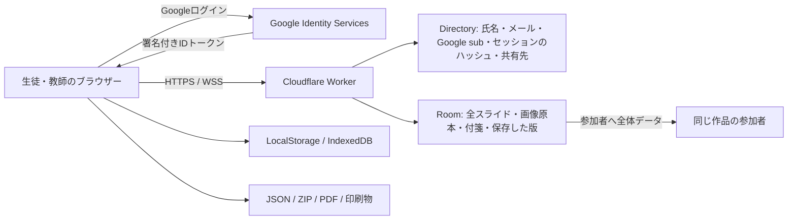

# VHSlide 0.38.1：生徒の個人情報・漏えいリスク監査

調査日：2026-10-24（日本時間）。対象：現在のリポジトリと公開中のCloudflare構成。個人情報を実際に含む本番ルーム、実生徒のGoogleアカウント、本番DBにはアクセスしていない。

## 1. 結論

**「個人情報が外部に漏れる可能性がない」とは判定できない。個人情報を扱う授業での利用を広げる前に、共有・端末内保存・削除の扱いを改善する必要がある。**

未認証者や未参加アカウントが作品・画像を直接取得する問題は、今回の試験では発見していない。署名検証、作品単位の参加確認、ホスト専用API、サーバー側の編集権限には実効性を確認した。

一方で、次を架空データで再現した。

1. 共有を解除した参加者が、有効な招待リンクから再参加し、再び作品を閲覧できる。
2. 行・列の編集範囲を制限しても、参加者には作品全体のデータ・他の行の画像・付箋が渡る。フィルタは閲覧権限ではない。
3. サインアウトしても作品のJSONとYjsキャッシュが端末内に残る。同じブラウザープロファイルの次の利用者から読み取れる。
4. 削除したスライドの画像と付箋を、参加者が引き続き取得できる。
5. 写真の原本をそのまま保存・配布するため、EXIF情報も保持される。合成したEXIF・GPS情報入りJPEGで確認した。
6. 閲覧のみの参加者も、原本画像を埋め込んだ作品全体のJSONを保存できる。完全バックアップには共有先のメールアドレスも入る。

これらは**今回、新たに情報流出事件が発生したという意味ではない**。実装上の性質・再現できたリスクを示す。一般の共同制作ツールでも「閲覧できるものはコピーできる」という限界はあるが、教師が「担当以外は見えない」「共有解除で完全に締め出せる」「ログアウトで端末から消える」と理解すると、現状との隔たりが大きい。

アプリの修正・本番デプロイ・本番データの変更は行っていない。追加したのは独立した監査用スクリプト、架空の画像fixture、報告書と証跡だけ。0.38.1の検証済みアプリファイルのハッシュ一致も確認した。

## 2. 情報が渡る先

- 現在のCloudflare設定はWorker・Directory/Room Durable Objects・静的Assets。画像はRoomのSQLiteチャンクへ保存する。現在の本番構成でR2やRailwayへ送っているとは確認されない。[`wrangler.jsonc`](../wrangler.jsonc)、[`room.ts`](../cloudflare/room.ts#L431)
- Googleの氏名・メール・アカウント識別子を受け取り、アプリ側でも保存する。Google DriveやGmailを読む処理・そのアクセストークンの保存は対象コードに見つからない。ログイン用の公開クライアントIDは秘密鍵ではない。[`directory.ts`](../cloudflare/directory.ts#L453)、[`CloudPanel.tsx`](../src/CloudPanel.tsx#L116)
- TLSは通信経路を保護するが、このアプリにエンドツーエンド暗号化はない。サーバーのコードは作品・画像・氏名を読める。運営者の管理権限やCloudflare側の処理・保管も信頼する構成であり、「学校外に一切送信しない」構成ではない。
- Cloudflare・Googleの契約、保存地域、サポート時のアクセス、バックアップ保持、アカウントの二要素認証、実際のログ設定は今回未確認。法令適合や学校での採用可否をこのコード監査だけで保証しない。

## 3. 相手別に確認した範囲

| 相手                                   | 結果                                                                                                 |
| -------------------------------------- | ---------------------------------------------------------------------------------------------------- |
| 未ログインの人                         | 独立したNode/Cloudflareで作品・画像・付箋・行名・履歴・完全バックアップの取得を401で拒否             |
| ログイン済みだが未参加の人             | 同じ対象を404で拒否。作品IDや画像URLを知っているだけでは取得できなかった                             |
| 参加済み・閲覧のみの人                 | 全スライド、画像、付箋は取得可能。作品全体のJSONも実際に保存できた                                   |
| 参加済み・一部の行だけ編集できる人     | 他の行も取得可能。ただし、権限外の更新はWebSocket経由でもサーバーが拒否                              |
| ホスト                                 | 他者の氏名・メール・権限・完全バックアップを取得できる。管理上の意図された権限であり、保管責任を伴う |
| 共有解除された人                       | 直後の取得は拒否される。しかし有効な招待リンクを再利用すると再参加できた                             |
| 同じブラウザープロファイルを使う次の人 | 前の人のサーバー上の作品は取得できないが、端末内の残存JSON・キャッシュは読み取れた                   |
| ダウンロード済みファイルを受け取った人 | そのファイルの内容を読める。後からアプリの共有を解除しても回収できない                               |

## 4. 発見事項と対策

### PRIV-01：担当・フィルタは閲覧制限ではない（P1：仕様と利用目的の整合）

**再現済み。** 0行目にだけ編集権限を与えた架空の生徒が、1行目のタイトル・本文・画像をAPIから取得できた。WebSocketの初期同期にも全作品が入る。付箋も作品全体を取得する。

根拠：[`directory.ts: access / GET work`](../cloudflare/directory.ts#L149)、[`room.ts: /state / /live`](../cloudflare/room.ts#L482)、[`room.ts: /comments`](../cloudflare/room.ts#L352)、[`cloud.ts: open`](../src/cloud.ts#L365)。Nodeも同じ結果。

これは編集権限を破っているのではなく、**作品単位で閲覧を許可する設計**。他の生徒に見せたくない成績、健康情報、個別の相談、非公開の回答を、フィルタで隠して同じ作品に入れてはいけない。

対策：まず「担当以外も閲覧できます」と共有画面で明示。個別秘密情報は別作品で共有する。行・列ごとの閲覧制限まで必要なら、APIだけでなくCRDT・WebSocket・画像・付箋・版・エクスポートを含めて設計変更が必要。UIで隠すだけでは対策にならない。

### PRIV-02：共有解除した相手が招待リンクで再参加できる（P1：高）

**Node/Cloudflareで再現済み。** `members/:user`削除後は404となるが、以前の有効な招待リンクをacceptすると200となり、作品を再取得できる。編集権限が戻らなくても、閲覧だけで個人情報は読める。

根拠：[`directory.ts: invitation accept`](../cloudflare/directory.ts#L766)はリンクの有効性だけでメンバーを挿入し、解除済みアカウントを記録しない。[`DELETE members`](../cloudflare/directory.ts#L1269)も招待トークンの失効・アカウント拒否記録を行わない。Nodeは[`invites/accept`](../server/app.ts)と参加者削除で同じ挙動。

リンクを持ち、アプリにGoogleでログインできるアカウントは参加できる。アプリ側に学校ドメイン・共有先メールに限定する招待チェックはない。実際のGoogle OAuth同意画面が内部向けか外部向けか、学校管理者が何を許可しているかは未確認であり、本番で任意のGoogleアカウントがログインできるとまでは断定しない。

**既存機能での暫定対策も再現済み：招待リンクを無効化してから対象アカウントの共有を解除すると、そのリンクでの再参加を拒否できた。** リンクの無効化だけでは既存メンバーを解除しないので、両方が必要。事前共有したアカウントだけで足りる場合は、開放的な招待リンクを発行しない。

恒久対策：招待の期限、対象アカウント限定、解除済みアカウントの再参加拒否と明示的な再許可、学校・作品ごとの参加ポリシーを設ける。

### PRIV-03：ログアウト後も端末内に作品が残る（P1：高）

**実ブラウザー操作で再現済み（Linux Chromium）。** サインアウト後、サーバーセッションは無効になったが、次が残った。

- LocalStorage：`vhslide-cloud-deck:<作品ID>`に作品JSON。キーに利用者の識別を含まない。
- IndexedDB：`vhslide-cloud/documents`に`Google sub/作品ID`をキーとするYjsの作品データ。

別の架空アカウントへ切り替えても、同じプロファイルから前の作品のタイトルを読み取れた。IndexedDBはバイナリだが、暗号化ではなくYjsで復号不要の再構築ができる。アカウントIDをキーに付けてもアクセス制御にはならない。

根拠：[`App.tsx: 自動保存`](../src/App.tsx#L578)、[`cloudCache.ts`](../src/cloudCache.ts)、[`cloud.ts: cache / signOut / detach`](../src/cloud.ts#L377)。`signOut`や`detach`にキャッシュ消去はない。

通常の作品一覧に前の利用者の作品が表示される、別のPCから無認証で読み取れる、という試験結果ではない。同じOS/ブラウザープロファイルを共有する人、同じオリジンで動く悪意のあるスクリプト等が問題となる。ブラウザーの拡張機能・端末管理者による閲覧も別途信頼する必要がある。

対策：サインアウト時の「この端末から作品を消す」、利用者ごとのキャッシュ管理と有効期限、共有端末モード、未送信変更の保存・破棄を選べる終了処理。現在は個人別の管理されたChromeOS/OSアカウントを使い、共用プロファイルを避ける。

### PRIV-04：オフラインではサインアウトが拒否される（P1：共用端末）

**再現済み。** 接続を切ってからサインアウトすると「保存の完了を待つか、先にJSON…」となり、セッションCookieも残った。[`cloud.ts: signOut`](../src/cloud.ts#L600)

未送信データ保護の意図は理解できるが、離席する際の安全な終了とは両立できていない。オフラインではサーバーの失効を保証できないため、その限界を明示しつつ、書き出し・破棄を選べる端末側の終了・キャッシュ消去を用意する。現状のセッションは7日間持続し、学校のGoogleアカウント停止を毎回Googleへ照会する実装もない。実Workspace停止時の挙動は未確認。[`directory.ts: auth/session`](../cloudflare/directory.ts#L453)

### PRIV-05：消したスライドの写真・付箋が引き続き読める（P1：削除の期待との隔たり）

**Node/Cloudflareで再現済み。** ホストがスライドを削除し、保存ACKを受けた後も、参加者は既知の画像URLを200で取得でき、付箋一覧から削除済みスライドのコメント本文を取得できた。

画像は版の復元のためにも保管され、取得時には作品への参加を確認するが、現行スライドに参照されているか・過去版だけの画像かを区別しない。付箋のGETもスライドの現存で絞らない。[`directory.ts: assets GET`](../cloudflare/directory.ts#L1347)、[`room.ts: comments/assets`](../cloudflare/room.ts#L352)、[`historyStore.ts`](../src/historyStore.ts)

対策：通常の削除と機密情報の消去を区別し、削除済み付箋・過去版だけの画像を一般参加者へ配信しない。保存した版に残す範囲と、履歴を含めて消去する操作を明確にする。既に保存された画像やスクリーンショットは回収できない。

作品全体をごみ箱に入れた場合は閲覧を拒否した。作品を完全削除した後も画像を取得できる問題は、今回の試験では認められなかった。ただし下記のアカウント・ジョブ情報や基盤側バックアップまで消えたという意味ではない。

### PRIV-06：氏名・アカウントの手掛かりが参加者へ配布される（P2、匿名利用が必要ならP1）

**一部再現済み・一部コード確認。** 行名の表示を有効にしなくても、`row-accounts` APIは割り当てられた名前を返す。未参加の事前共有先はメールの@より前が返り、学籍番号等の識別情報になりうることを確認した。

[`preSharing.ts: sharedAccountNames`](../src/preSharing.ts#L109)は通常、フルメールや権限オブジェクトを返さない。一方、参加後はGoogleの表示名を使い、表示名が欠ける場合はログイン処理でメールを名前に採用する。表示名そのものがメールの場合もあるので、「全ケースでメールは出ない」とは保証できない。[`directory.ts: user.name`](../cloudflare/directory.ts#L480)

接続中の参加者一覧は名前とGoogleの`sub`に由来するID、付箋は投稿者名・投稿者IDを他の参加者へ返す。[`room.ts: presence`](../cloudflare/room.ts#L152)、[`room.ts: comments`](../cloudflare/room.ts#L352)。ホスト専用のフルメール一覧を一般参加者へ返す問題は試験では確認されなかった。

対策：作品内のニックネーム・出席番号などを別に設定し、未参加アカウントのメール接頭辞は配らない。Google表示名の公開と教師用の連絡先を分離する。画面表示オフを「データを配信しない設定」と取り違えないようにする。

### PRIV-07：写真のEXIF・GPS等のメタデータを保持する（P1〜P2：写真の内容次第）

**合成JPEGで再現済み。** 2×2ピクセルの架空画像にArtistとダミーGPSタグを付け、保存後の取得バイト列が元画像と一致することをNode/Cloudflareで確認。閲覧のみの参加者が保存したJSONに埋め込まれたJPEGも原本と一致した。

表示上の大きさを小さくしても、アップロードするファイルは原本のまま。[`App.tsx: addImage`](../src/App.tsx#L736)、[`cloud.ts: upload / portableDeck`](../src/cloud.ts#L55)、[`directory.ts: saveAsset`](../cloudflare/directory.ts#L259)

実際の生徒の写真にGPSが入っていたかは未確認であり、調べていない。メタデータに加え、顔、名札、掲示物、校名、位置を特定できる背景は画像そのものからも分かる。

対策：アップロード前の安全な画像再エンコード・EXIF等の除去。必要に応じて匿名化・トリミング。既存の写真の処理は原本維持・復元との関係を設計し、単なる表示縮小で済ませない。

### PRIV-08：書き出したファイルは認証・共有解除で保護できない（P1〜P2）

**閲覧専用の参加者によるJSON保存を再現済み。** 全体のJSONと原本画像を保存できた。PDFも内容の匿名化を行う機能ではない。閲覧権限を与えた情報の撮影・転記までWebアプリだけで禁止することはできない。

完全バックアップの`work.json`には氏名・共有先メール・権限・付箋が含まれ、ZIPは暗号化されていない。[`backupData.ts: backupSnapshot`](../src/backupData.ts#L80)、[`backupArchive.ts`](../src/backupArchive.ts#L64)、[`full-backup.md`](full-backup.md#L16)

「共有権限を復元しない」というチェックの既定値は、**復元先の権限**を制御するもので、元ZIPから共有先メールを除去する機能ではない。SHA-256による整合性確認も暗号化や匿名化ではない。

対策：共有先情報を含めない書き出し、教師用バックアップと提出・配布用ファイルの分離、個人情報を含む注意の表示。保存先は学校が認めた場所にする。必要な暗号化・鍵管理は別途設計する。

### PRIV-09：個人情報の保管期間・退会・消去仕様が不十分（P1：運用整備）

**コード確認。** `users`に氏名・メール・Google IDを保存し、ユーザー削除・退会のAPIやUIは見つからない。復元ジョブは作品を完全削除しても、冪等性のためID・所有者・作品名等を保持する。作品名が個人情報なら、このメタデータにも残る。[`directory.ts: schema/removeWork`](../cloudflare/directory.ts#L70)、[`backupProtocol.ts: restoreSchema`](../src/backupProtocol.ts#L26)

作品削除ではRoomの画像・本文・付箋・版を削除する処理を確認したが、学校年度末の利用者情報の消去や、Cloudflareのバックアップから物理的に消える時期は未確認。Directoryの期限切れセッション掃除も単発alarmで、定期的に続く保証は別途見直す必要がある。[`directory.ts: alarm`](../cloudflare/directory.ts#L1364)

対策：利用目的、保存期間、学校からの削除依頼、年度末処理、法的・運用上残す最小メタデータを定める。個人情報の管理者・問い合わせ先・外部サービスへの送信を説明するプライバシー案内も必要。一般利用者向けのまとまった案内画面は対象コードに見つからなかった。

### PRIV-10：運営権限・外部基盤・ログは未監査の範囲を残す（P1：設定確認）

- アプリ側に広告・独自アクセス解析・AI送信の処理は見つからない。Googleのサインイン用JavaScriptは外部から読み込む。Google/Cloudflareが受け取る通信メタデータ、IP、処理ログ、保存地域、契約上の取扱いまでは確認できていない。
- 招待トークンは`?join=`というURLの一部。`open`成功後は`history.replaceState`で作品URLに置き換え、`Referrer-Policy: no-referrer`もあるが、初回リクエストはURLを含む。Cloudflare等のログに残るか・誰が見られるかは設定確認が必要。[`cloud.ts: openLocation/open`](../src/cloud.ts#L286)、[`index.ts`](../cloudflare/index.ts#L32)
- 同期データの本文を`console.log`するアプリ処理は見つからない。しかし、これは基盤全体にログがない証明ではない。
- Cloudflare/GitHubの管理アカウント、デプロイトークン、Google OAuth設定に対する二要素認証・最小権限・アクセス監査は未確認。これらが侵害されるとアプリの通信や保管データも影響を受ける。
- ブラウザーの高度なスペルチェック、音声入力、拡張機能、OSのクラウドクリップボード等は別の送信経路となりうる。ローカル文字編集は`spellCheck`を有効にしているが、実学校端末のポリシーや実際の外部送信は未確認。[`InlineText.tsx`](../src/InlineText.tsx#L60)

現在のCloudflare構成では画像のURLも認証を要求する。Nodeの任意S3構成には60秒の署名付きURLへの転送があるが、それは現在のCloudflare本番で使っていると確認した機能ではない。[`server/storage.ts`](../server/storage.ts)

### PRIV-11：依存関係の既知警告（P2：到達性を区別）

`npm audit --omit=dev --json`で本番依存にQuill 2.0.3の警告1件（npm判定low）が出た： [GHSA-v3m3-f69x-jf25](https://github.com/advisories/GHSA-v3m3-f69x-jf25)、HTML exportのXSS。現在の`CloudText`は`formats: []`で使い、対象コードに`getSemanticHTML`等のHTML export呼び出しは見つからない。[`CloudText.tsx`](../src/CloudText.tsx#L20)

この警告を、そのまま本アプリで個人情報を盗める実証とは扱わない。HTML文字列を本文に入れる限定的なブラウザー試験では、タグの実行・指定した攻撃者ドメインへの送信は起きなかった。別のDelta・貼り付け・HTML書き出し経路や将来追加する機能まで網羅したXSS検証ではない。更新・代替の検討時は互換性とアドバイザリーの条件を確認し、監査ツールの候補へ機械的にダウングレードしない。

## 5. 機能していた防御

| 防御                                               | 根拠と確認結果                                                                                                                                                     |
| -------------------------------------------------- | ------------------------------------------------------------------------------------------------------------------------------------------------------------------ |
| Google署名・issuer・audience・期限・確認済みメール | `directory.ts: auth/google`、既存Cloudflare JWT試験。署名不正・違うaudienceを拒否。Nodeの本番も`jwtVerify`を使用                                                   |
| セッション                                         | 32バイト乱数、DBにはハッシュ。CookieはHttpOnly/SameSite=Lax、HTTPSでSecure。ログアウト後は古いCookieで取得不可                                                     |
| 作品・画像の直接取得                               | 参加確認あり。未認証401、未参加404を両バックエンドで確認。画像はprivate/no-store                                                                                   |
| メール一覧・過去版・完全バックアップ               | ホスト専用の取得を一般参加者に拒否                                                                                                                                 |
| 不正な編集                                         | UIを迂回したWebSocket更新もサーバーで拒否。安定した行列IDの検証・認可も既存試験が成功                                                                              |
| CSRF / WebSocket Origin                            | 他オリジンの変更を403で拒否。既存試験でもOrigin違反を拒否                                                                                                          |
| 内部DOのAPI                                        | 公開Workerが`/api/`のみDirectoryへ転送する構成。公開の`/internal/...`へ到達しただけでDOの処理を呼べるものではない。HTMLのSPA fallbackの200を認可成功と取り違えない |
| HTML・外部画像                                     | React/textContentによる文字描画、色の形式検証、画像は画像data URIまたは同一アプリの認証付きURLのみ。SVG/任意外部画像をモデルが許可する構造ではない                 |
| 配信ヘッダー                                       | CSP、nosniff、no-referrer、frame-ancestors none。公開トップページのヘッダーも読み取りで確認                                                                        |
| バックアップ復元                                   | 既定で共有復元OFF、新規作品・未確定非公開・冪等性。既存の故障注入A/B/Cが成功                                                                                       |

TLS、Cookie属性、CSPだけで端末内データ・持ち出したファイル・運営者権限からの閲覧を防げるとはしない。

## 6. 試験と証跡

証跡：[privacy-2026-10-24](audit-evidence/privacy-2026-10-24/)。架空の名前・メール（`example.test`）・ダミーGPSを使用した。

| 実施                                                     | 結果                                                                                                                                                                             |
| -------------------------------------------------------- | -------------------------------------------------------------------------------------------------------------------------------------------------------------------------------- |
| 新規API監査 `node tests/audit/privacy-audit.ts`          | NodeとMiniflareの独立した環境で28の観察・検証を記録。14件は7種類のリスクを各バックエンドで再現。残りは防御・暫定対策等を確認。リスクを記録した試験を「安全性の合格」とは数えない |
| 新規ブラウザー監査 `node tests/audit/privacy-browser.ts` | Linux Chromium。実サインアウト、オフライン終了拒否、次アカウントでの残存データ読み取り、閲覧専用でのJSON保存、限定的なタグ非実行試験を確認                                       |
| 既存 `npm test`                                          | 単体87件、Node API14件成功                                                                                                                                                       |
| 既存 `npm run test:cloudflare`                           | 型検査・dry-runと19件成功。署名、Origin、未参加者、他作品画像、セッション失効、認可・復元等を含む                                                                                |
| 依存関係監査                                             | 本番依存にlow 1件、high/critical 0件。これだけで脆弱性がないとは判定しない                                                                                                       |
| 本番の匿名・読み取り確認                                 | `/`200、`/api/session`200でuser:null、`/api/decks`401。公開ルームのIDを使わず、作品・生徒データを取得していない                                                                  |
| 実データ・実機                                           | 実Chromebook・iPad/Safari・Workspaceのアカウント停止・実Google OAuth設定は未検証                                                                                                 |

`source-sha256.txt`は監査時点のアプリ・監査スクリプトのハッシュ。画像fixtureは`tests/audit/fixtures/privacy-photo.jpg`。API試験は架空のID検証器（Node）とテスト鍵によるGoogle JWKS応答（Cloudflare）を使い、実Googleのログイン可否・契約を試すものではない。本番の認証器にテストの抜け道を追加していない。

## 7. 優先順位と当面の扱い

**最初に修正したい項目**は、(1) 共有解除した相手の再参加制御、(2) ログアウト・端末内キャッシュ消去、(3) 閲覧範囲と編集範囲の明示・必要なら閲覧権限の設計である。その後、削除済み情報の配信停止、写真メタデータ除去、氏名表示とバックアップの最小化、保存期間・削除手続きを整備する。

現状の機能だけでリスクを下げる場合：

1. 成績・健康・家庭事情・個別相談などの機密情報をこの共有作品へ入れない。非公開の回答は別作品にする。
2. Google名や写真が他の参加者へ渡る前提で、必要な表示名・写真だけを使う。生徒名を作品タイトルや画像メタデータに入れない。
3. 事前共有するアカウントを限定し、不必要な招待リンクは無効化する。相手を外すときはリンク無効化と共有解除を合わせて行う。
4. 個人別の管理されたOS/ブラウザープロファイルを使用する。共用プロファイルでは、必要な未送信データを書き出した上で、学校の手順に従ってサイトデータを消す。サイトデータを消すと端末内の作品・未送信変更も消える点に注意する。
5. JSON・ZIP・PDFは学校が認めた保存先で管理し、メール・個人クラウド等への持ち出しを運用で制限する。
6. Cloudflare・Googleの契約、OAuthの対象者、管理権限、ログ・保持期間と学校の情報セキュリティ方針を照合する。

今回の監査は、侵入被害の有無のフォレンジック調査、網羅的なペネトレーションテスト、法令適合認証ではない。**外部の無関係な人への直接取得防止は確認できた一方で、リンク・共同編集者・共用端末・書き出しを通じた漏えいリスクは実在する**、というのが現在の判定である。
